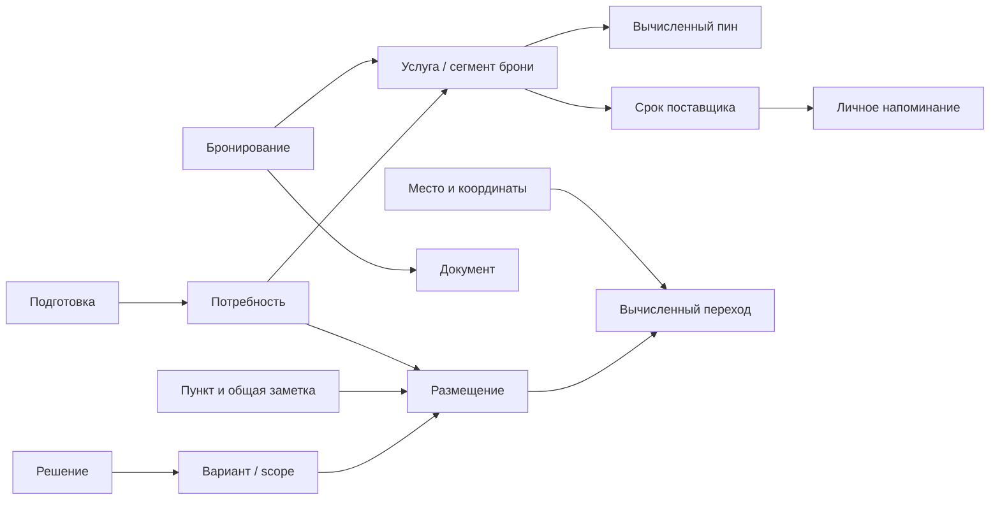

# Архитектура маршрута, подготовки, вариантов и подтверждений

Статус: этапы 1–6 реализованы и проверены локально. Публикации нет.
Следом завершена [подготовка выпуска и восстановления](2026-11-14-route-release-readiness.md).
Приняты «Маршрут и подготовка» и «Явная готовность». Итог интеграции — раздел 21.
Дата: 2026-11-14. База сверки: main 7463ce8ef2159fe67c0a2e0bb63b365c435ae7ef.
Оболочка и последующие изменения main дополнительно сверены на `163b6ae`.
Для этапа 6 в рабочую ветку влит `origin/main` на `588322a`.
Основание: запрос подготовить архитектуру для последующей реализации.

Это техническая часть [единой продуктовой спецификации](2026-11-14-route-first-planning.md),
а не отдельная фича. Согласованное продуктовое поведение имеет приоритет.
Здесь определены поля, связи, вычисления, команды, миграция и проверки.

Связанные документы: [архитектура](../docs/ARCHITECTURE.md),
[планирование](../docs/PLANNING.md), [правила поездки](../docs/PLANNING_RULES.md),
[напоминания](../docs/WEB_PUSH_TIMEZONES.md), [плагин](../docs/CHATGPT_PLUGIN.md),
[доступ](../docs/PUBLIC_ACCESS_PASSKEYS.md), [выпуск](../docs/DEPLOYMENT.md).

## 1. Границы и порядок работы

Сохраняем Pages/ES modules, MapLibre, существующий Node/SQLite на VPS.
Графовая БД, внешний планировщик, AI в цикле проверок, дорожный API,
новая очередь и поиск логической связи по свободному тексту не нужны.

План проектирования: аудит существующего кода → источники истины и связи →
общий пересчёт и операции → совместимость/миграция/файлы → сквозная проверка
сценариев. Все пять проходов отражены ниже. Реальная поездка не меняется.
Финальный дизайн и публикация не входят в эту работу.

## 2. Проверенная основа и необходимые изменения

| Участок | Сейчас | Изменение |
|---|---|---|
| drizzle/0007, 0011 | Пять kind в planning_items, время и state вместе | Отделить размещение и обязательства от идентичности |
| src/planning.mjs: writeRelations | DELETE/INSERT опций и ссылок | Адресные updates по стабильным ID, архивирование |
| planning-validation.mjs | stay требует объект, transport — endpoints | Неполный placeholder допустим, готовность проверяется отдельно |
| planning-decisions.mjs | Выбор главным образом меняет состояния мест | Новый режим route_segment без скрытия мест побочным эффектом |
| planning.mjs | cancelled не блокер; ack_dependencies допускает done | Legacy сохранить, обязательный результат проверять независимо |
| planning-pilot-model.js | Перенос даты одного item, предупреждение fixed_external | Общий расчёт слотов/пинов/групп/длительности |
| planning-travel.js: coversNight | Неотменённый stay покрывает ночь | Активный вариант + действующая подходящая услуга |
| src/catalog.mjs: has_stay | Самостоятельный SQL по stay | Общая проекция покрытия |
| reminders.mjs, push-scheduler | Якорь из item; активность по state | Якорь рабочего placement и применимость |
| assistant-proposals/changes | Snapshot/savepoint/подтверждение | Полный snapshot новых сущностей, единое применение |
| server/import-planning.mjs | applyPlanningChange в транзакции | Адаптер нового командного слоя |

Старые решения с affects_visit остаются legacy_place до явного преобразования.
Нельзя угадывать из них многодневные сценарии. Модульные документы пока описывают
реализованное поведение, не переписываются как отчёт о будущей системе.

## 3. Инварианты

1. Пункт существует до подготовки. Покупка не создаёт второй экземпляр посещения.
2. Item, placement, task, need, service и document имеют разные стабильные ID.
3. Общая пользовательская заметка принадлежит item, не снимку дня/варианта.
4. Участие, утверждение времени, готовность и факт выполнения независимы.
5. Task.done не доказывает действительность билета.
6. Смена working изменяет намерения, не факты поставщика.
7. Связи используют ID, не заголовки, позиции массивов или текст.
8. Обратная навигация получается из прямой связи, не хранится второй копией.
9. Неизвестная семантическая связь требует ввода; AI не обязателен для её создания.
10. Preview не меняет поездку, уведомления и файлы; apply атомарен.
11. Производные ready/pin/conflict не принимаются от клиента как факты.
12. Отмена одного источника пина не снимает другие.
13. Отсутствие данных не считается успешной проверкой.
14. Аккаунты участников не равны пассажирам/количеству билетов.
15. Публичная карта не раскрывает условия, документы и приватные причины ошибок.

## 4. Соглашения хранения

Это проект схемы, не исполняемая SQL-миграция. Номер новой миграции выбрать
от актуального main перед реализацией; применённые миграции неизменяемы.

- ID — непрозрачные строки: UUID для новых UI-записей; существующие
  детерминированные `plan-…` из импорта сохраняются. Клиент не разбирает ID.
- У предметных строк: id, trip_id, version INTEGER >=1, created_at/updated_at
  (epoch milliseconds), created_by/updated_by. У ссылок собственный ID,
  если на них ссылаются UI, история или другие записи.
- Все ссылки принадлежат одной поездке. Составные FK через UNIQUE(trip_id,id)
  там, где возможно; сервер проверяет kind, scope и права.
- Новые удаления — archived_at/archived_by, отличные от отмены. Предметные FK
  используют RESTRICT. CASCADE — только для временных технических данных.
- JSON допустим для типизированных значений условий, истории и команд.
  Предметные связи хранятся в FK-колонках/таблицах, не внутри свободного JSON.
  Произвольные выражения или исполняемые формулы не поддерживаются.
- Длительности/количества — целые; UTC сохраняет существующую точность до ms.
- Изменение дочерних ссылок увеличивает version агрегата. Новый
  trips.planning_revision увеличивается при любой общей правке, влияющей
  на план/объяснения. Старый planning_version пока остаётся версией дат поездки.
- Повтор команды сохраняет выделенные ID; связи не пересоздаются целиком.
- Индексы на все обратные FK и trip_id; уникальности живых связей частичные
  по archived_at IS NULL. FK на новые архивированные цели нельзя создать
  обычной командой, историческая ссылка остаётся.

## 5. Предметные сущности

### 5.1. planning_items: идентичность и факт

Сохранить ID, kind, title, description, note, priority, assignee_id, state,
completed_at, версии и аудит. Добавить:

| Поле | Тип / смысл |
|---|---|
| archived_at, archived_by | Мягкое удаление |
| activation_scope_id | FK planning_scopes, root для общих записей |
| route_owner_decision_id | nullable FK decision, один владелец вариантных размещений |
| decision_mode | null / legacy_place / route_segment, только decision |
| task_activation | independent / linked_needs / scope, только task |
| completion_placement_id | nullable FK placement, контекст отметки «состоялось» |
| completion_snapshot_json | Типизированное состояние размещения при отметке; legacy null |

state=open/in_progress/done/cancelled остаётся фактом работы/выполнения.
У visit/stay/transport done означает «состоялось», а не «билет готов».
У route_segment state — совместимая проекция специального состояния решения.
Смена kind после появления новых связей требует отдельной конверсии с impact.

У маршрутных items старые date_*/starts_at/ends_at/event_timezone становятся
совместимой проекцией рабочего placement, не вторым источником истины.
У tasks существующий рабочий период сохраняется; переход одиночной цели
к deadline описан ниже. transport_json сохраняет общие
сведения переезда; расписание, пояса, вариантные endpoints принадлежат placement.
Если варианты меняют сам смысл транспорта, создать разные items, а не
подменять одной идентичностью несвязанные перелёт и прогулку.

Второе самостоятельное посещение того же места — новый item. Один item в
альтернативах означает одну предполагаемую поездку/активность в разных условиях,
поэтому note и факт выполнения общие. После done варианты не могут превращать
его в новое будущее посещение: предложить создать новый item с исходной ссылкой.
Исправление ошибочного факта — отдельное действие с причиной и историей.
Отметка happened сохраняет completion placement и snapshot известных даты/времени/
поясов/подписи; completed_at — время отметки, не придуманное фактическое прибытие.
Snapshot помечен reported_plan, пока реальные часы не внесены явно. Последующая
смена варианта не переписывает этот факт: история дня включает его даже при
неактивности исходной ветви. Архивирование также не скрывает совершённое из истории.
Для старого done без надёжных данных completion snapshot остаётся unknown.

Для совместимости старые временные колонки маршрутного item обновляет только
серверная проекция рабочего placement в той же транзакции. Прямой writer этих
колонок запрещён; при отсутствии active placement они очищаются, даты inactive
вариантов доступны через model3. Проекция восстанавливаема из placements.
При изменении её или дочерних связей растёт item.version; note не копируется.
Новый scheduler и проверки читают доменную проекцию, а не эти колонки.

### 5.2. Контексты: planning_scopes, planning_decisions, planning_options

planning_scopes: id, trip_id, parent_scope_id nullable, option_id nullable UNIQUE.
Один root на trip (оба NULL); остальные scopes соответствуют опциям.
parent scope опции равен scope её decision. Это дерево применимости, не копии поездки.

planning_decisions (PK/FK item_id): scope_id, working_option_id nullable,
accepted_option_id nullable, resolution=open/accepted/review, version.
Выбранная опция обязана принадлежать этому decision.
planning_options сохраняет существующие поля и получает version/archived_at.
Переименование не меняет scope и ссылки.

Начальная граница реализации: корневое решение + один вложенный уровень,
один parent, без циклов/общего ребёнка двух решений. Это техническое предложение,
не ранее утверждённое пользователем точное число. Более глубокий сценарий
остаётся личным черновиком с UNSUPPORTED_NESTING и ссылками на проблемную цепочку.

Working projection = root + цепочки working_option. Локальное сравнение
подменяет выбор только для вычисления. Reopen оставляет working_option,
сохраняет последний accepted_option для истории, ставит review.
Новый accept обновляет accepted_option. Смена working при accepted требует reopen.

Невыбранную альтернативу можно добавить без сброса принятого выбора.
Правка активной альтернативы/общих условий принятого решения требует пересмотра.
Новый факт поставщика сохраняется при accepted, но может породить issue.
Удаление выбранной опции требует replacement/clear_working в том же пакете.

Явные условия между разными решениями: planning_option_constraints(id,
option_id, relation=requires_option/excludes_option, other_option_id, version,
archived_at). Цели — существующие опции другой decision той же поездки.
Все условия source option соединяются AND; OR выражается вариантами,
произвольные формулы не вводятся. Направление excludes одностороннее в хранении,
несовместимость показывается с обеих сторон. Self-link, requires/excludes
одной цели и заведомо недоступная комбинация родителей запрещены.

Requires означает «нужен такой рабочий вариант», а не «требуется купить билет».
Если целевой выбор не сделан, результат unresolved; выбран несовместимый —
conflict. Новое условие не переключает другое решение молча. Preview предлагает
конкретный пакет переключений или сообщает ограничение. Автоматический решатель
произвольных комбинаций не нужен. Циклы requires между decisions не поддерживать;
взаимозависимые решения объединять или вкладывать. Excludes не ребро этого DAG.

Изменённое время, неподходящий билет и ownership вычисляются и без такой записи.
Option constraint нужен только для самостоятельного смыслового условия,
которого нет во времени/покрытии/вложенности. UI «Этот вариант требует …»
создаёт ссылку, formatter подставляет актуальные названия. Новая альтернатива
сразу проходит все общие проверки; её смысл не извлекается из названия через AI.

### 5.3. planning_placements: размещение намерения

| Поле | Смысл |
|---|---|
| item_id, scope_id | FK; UNIQUE живой пары |
| participation | included / excluded |
| commitment | tentative / approved |
| precision | unscheduled / day / part_of_day / approximate / exact |
| date_start, date_end | Локальные даты, nullable по precision |
| starts_at, ends_at | UTC ISO, nullable по precision |
| start_timezone, end_timezone | IANA, могут различаться у транспорта |
| part_of_day | morning/afternoon/evening/night/null |
| intended_duration_minutes | >0 или null |
| order_key | Порядок недатированных/одинаково датированных |
| location_state | unspecified / candidates / chosen |
| version, archived_at | Конкуренция и история |

Если route_owner_decision_id NULL, у маршрутного item один placement в activation_scope.
Иначе его placements относятся к scopes опций ровно этого владельца;
activation_scope item равен scope владельца. Отсутствие placement в опции
означает исключение. Две строки одного item не могут быть активны одновременно.
Общие пункты не копируются, notes остаются общими.

Placements создаются только для visit/stay/transport. Task и decision не занимают
временной слот маршрута; их сроки/условия представлены собственными связями.

Вложенный decision управляет своими items; родитель включает его через scope,
не пишет второй набор часов этих же items. Два независимых владельца дают
MULTIPLE_PLACEMENT_OWNERS, даже если сегодня значения совпали. Предложить
объединение решений или явную передачу владельца с impact по всем опциям.
Это сознательный предел простых вложений вместо произвольного наложения patches.

Exact visit/transport: start < end; duration согласована с обоими моментами.
Противоречащие end и duration отклоняются. Approximate не считается проверенным
слотом. Unknown duration останавливает автоматический перенос.
Stay: date_start < date_end, ночи [заселение, выезд); stay не занимает все часы дня.
Approved плановое время может ещё требовать покупки: readiness отдельна.

Для precision=day/part_of_day хранятся даты и при необходимости part_of_day,
UTC моменты пусты; unscheduled допускает только относительный порядок.
Approximate хранит желаемый интервал, но явно не обещает точного времени.
У stay даты обязательны для покрытия, timezone обязателен при выбранном объекте;
placeholder без дат не покрывает конкретную ночь. У transport время и endpoints
могут уточняться по отдельности, незаданные поля не заполняются нулями.
Ночное посещение/перелёт остаётся одним интервалом, визуальное деление по дням
не создаёт новые placements. order_key только для представления/явного порядка,
он не отменяет хронологию известных моментов.

### 5.4. Места и координаты

Старые planning_item_places сохраняются для общих справочных/legacy связей.
Новые planning_placement_places: id, placement_id, place_id nullable,
role=visit/lodging/departure/arrival/reference, selection=candidate/chosen,
label_snapshot, coordinate_snapshot_json nullable, sort_order.
Place FK ON DELETE SET NULL оставляет подпись и историю.

Reference не участвует в дороге. Transport использует соответствующие endpoints.
Удалённые координаты не применяются бесшумно как актуальные: snapshot исторический,
будущий переход становится unknown до уточнения. Скрытие места связи не удаляет.
Свободно введённый адрес не получает придуманные координаты.
Несколько candidate допустимы; min-distance помечается неопределённостью.
Выбранный объект stay один, candidates не дают домика.

При наличии chosen расчёт использует только их; иначе — доступных candidates.
Если у одной стороны нет ни одной корректной точки, distance unknown.
Частично известный набор candidates даёт минимальную известную дистанцию
с issue о неполноте; это не доказательство достижимости остальных кандидатов.
В read model координаты имеют source/quality/version; строки reference исключены.
Удаление/изменение места проходит общий preview влияния на план и брони;
поставщик/историческая подпись услуги не переименовываются вслед за местом.

### 5.5. planning_needs: требуемый результат

Поля: id, scope_id, kind=admission/accommodation/transport/task_result/decision_result,
label, lifecycle=active/waived/retired, waived_reason nullable,
required_units INTEGER >0 nullable, unit_type=person/room/group/unspecified,
criteria_json, version, archived_at.

planning_need_targets: id, need_id, placement_id. Актуальные требования времени
и места берутся из target, не копируются в description.
Один need может обеспечивать несколько targets одним общим результатом.
Независимые результаты — разные needs. Неактивные targets не расходуют ресурс.
Lifecycle waived меняется явной командой с причиной; task.cancel его не меняет.

criteria_json — закрытая schema: вид услуги и требуемая определённость.
Ссылки отдельно: planning_need_task_results(need_id,task_id) и
planning_need_decision_results(need_id,decision_id,required_option_id nullable).
Task_result может обеспечиваться done; admission от task.done не закрывается.
Все result-ссылки одной потребности обязательны (AND); любая альтернатива
выражается scope/option. Для decision_result нужна resolution=accepted,
применимость решения и совпадение required_option, если она задана.
Working без принятия не равен выполненному decision_result.
Пустой набор result-ссылок означает missing, а не истинность пустого AND:
потребность может существовать до создания обеспечивающей задачи/решения.
Кандидаты неизвестного количества дают unknown по полноте, не «один на всех members».
Паспортные данные и персональная модель семьи ради этой фичи не вводятся.

Need scope — общий доступный предок его targets. В выбранном контексте учитываются
только included targets и scope; отсутствие активных targets даёт dormant,
а не satisfied. Общая потребность может ссылаться на взаимоисключающие placements
одного item: проверяется только выбранное размещение. Branch-specific потребность
имеет scope этой опции. Сервер проверяет достижимость каждого target из scope.
Архивирование последнего target показывает потерю применения и оставшиеся услуги,
не удаляет need/покупку автоматически. Новый visit без объявленных потребностей
имеет not_required, что означает только отсутствие известных требований.

### 5.6. Подготовка и дедлайны

planning_need_tasks: id, need_id, task_id, relation=produce/review, archived_at;
UNIQUE живой пары. Это работа, не доказательство готовности.
Для linked_needs task применим, пока нужен хотя бы один активный need.
Independent task остаётся применим независимо от маршрута.
Dormant — производная применимость, не новое состояние выполненной работы.

Task scope обязан быть предком всех его маршрутных назначений: общая покупка
для нескольких опций живёт в их общем scope. Для scope-режима достаточно
активности scope, для linked_needs нужен ещё активный need. Independent в root
не зависит от выбранного участка. Применимость задачи не равна открытости:
done/cancelled сохраняют факт и не запускают новые напоминания подготовки.

planning_service_tasks: id, service_id, task_id, action=exchange/cancel/review.
Работа с реальным обязательством не засыпает из-за неактивного варианта.
Отменённые назначения сохраняют историю. Возврат варианта использует открытую
задачу, а выполненную исходную покупку автоматически не переоткрывает.

planning_task_prerequisites: id, task_id, required_task_id nullable,
required_decision_id nullable, required_option_id nullable.
CHECK ровно одна категория цели, option принадлежит decision.
Циклы проверяются в графе обязательных действий и условий вариантов.
Производящие и информационные связи не являются рёбрами этого DAG.
Старые planning_dependencies остаются legacy до явного преобразования.

Для проверки цикла рёбра — task→required_task, task→required_decision,
decision→decision из requires_option. Need.task_result проверяет результат
у target, но связь task→need «подготавливает» не становится prerequisite:
иначе любая обычная покупка создала бы ложный цикл. Несовместимые prerequisites
по scope явно подсвечиваются, а не включают неактивную ветвь автоматически.

planning_deadlines: id, task_id nullable, service_id nullable,
kind=target/sales_open/sales_close/payment/cancel_by/check_in,
at UTC nullable, local_date nullable, timezone, origin=manual/provider,
source_url, note, version. Ровно один владелец; правила определённости даты ниже.
Для target добавить mode=manual/relative и aggregate=min; у прочих mode=null.
Ровно один вид даты обязателен, если срок известен. Relative target с неизвестным
anchor допускает обе даты NULL и возвращает unknown. at/local_date такого target
— совместимый вычисляемый кэш, обновляемый только общим слоем; rules источник истины.
Одиночная календарная цель task переводится в target deadline; старые колонки
служат совместимой проекцией с прежним способом отображения, включая date_end-only.
Старый task с периодом сохраняет рабочий период и прежний reminder anchor;
конец периода не объявляется дедлайном автоматически. Для него target deadline
появляется отдельным явным действием и имеет отдельную подпись в карточке.
Relative rules двигают target, а не весь рабочий период. Личная подписка на item
не переключается на новый deadline без выбора участника.
Внешний deadline не пропадает вместе с текстом description.

planning_deadline_rules: id, task_id, anchor_placement_id, anchor=start/end,
offset_minutes nullable, offset_days nullable, rule_timezone, enabled.
Ровно одна единица; minutes — elapsed, days — календарные дни в указанном поясе.
Несколько источников для одной задачи допустимы только с явным aggregate=min:
самый ранний применимый target, все причины в preview. Не брать первый из массива.
External deadlines и done tasks не сдвигаются. Конфликт target/hard deadline виден.
Прошедший срок не меняется на сегодня сам собой.

При завершении task последнее рассчитанное значение target сохраняется как
историческое; rules больше не меняют его, пока задача закрыта. Reopen показывает
preview нового значения по текущим anchors, sent reminders не перевооружаются.

У task не более одного target deadline: manual либо derived по активным rules,
mode=manual/relative хранится у target. Derived at — вычисление, ручной override
явно переводит mode и сохраняет прежние rules отключёнными. Прочие hard deadlines
не конкурируют за эту колонку. Относительный срок с неизвестным anchor = unknown;
при одном неизвестном из нескольких aggregate=min итог также неполон, даже если
известен ранний кандидат. Дата без часов не получает произвольное время напоминания.

### 5.7. bookings и booking_services

bookings: id, trip_id, category=activity/lodging/air/rail/other, provider_name,
reference nullable, note, source_urls JSON, version, archived_at.
Reference не UNIQUE, возможные дубли показываются без автоматического слияния.
Итоговый booking status вычисляется из услуг; один active не означает все сегменты.

booking_services: id, booking_id, kind=admission/stay/transport,
state=pending/held/confirmed/cancelled/used/expired/superseded, title,
validity=exact_start/exact_interval/date_range/open_window/unknown,
starts_at/ends_at UTC nullable, start_timezone/end_timezone,
date_start/date_end nullable, capacity_units nullable, unit_type,
hold_expires_at nullable, arrival_lead_minutes nullable,
exit_allowance_minutes nullable, terms_json, source_url,
replaces_service_id nullable, origin=manual/legacy_stay,
version, archived_at.

booking_service_places: service_id, role, place_id nullable, label_snapshot.
Для place FK — ON DELETE SET NULL с сохранением snapshot; исчезновение места
не удаляет факт услуги, но делает автоматическую сверку места неполной.
Реальные условия самостоятельны: перенос placement не переписывает service.
Terms — закрытые поля change_policy/cancellation_policy = allowed/forbidden/unknown,
notes, amount/currency при наличии. Возврат денег по тексту не вычисляется.
Точные сроки отмены принадлежат planning_deadlines.

record_cancellation фиксирует уже состоявшуюся отмену; запрос поставщику —
task/request, исходная услуга до факта действует. Cancelled терминален для
обычного редактирования. Ошибочную запись исправляет record_correction с причиной.
Замена — новый service с replaces_service_id. Изменение поставщиком той же
действующей услуги — amend_service с версией/before/after; выбранный план требует сверки.
Held даёт временную причину ограничения со сроком, но не полную готовность покупки.
Expired hold вычисляется по now, без AI. Used обеспечивает прошлый факт,
не повторное будущее использование. Действие билета сверяется с датой намерения,
а не только с текущими часами сервера.

Validity задаёт форму условий: exact_start фиксирует вход, exact_interval — оба
конца, date_range — ночи/даты, open_window — допустимые границы посещения,
unknown не создаёт выдуманного пина. Для окна criteria/terms содержат
min/max_duration при наличии; start и duration должны помещаться целиком.
arrival_lead_minutes — явное требование прибыть до начала услуги,
exit_allowance_minutes — время после её конца. Не выводить их из слова «самолёт».
Held с неизвестным expiry остаётся needs_review и требует уточнения, а не
бессрочной гарантии. Истечение подтверждённого периода не превращает confirmed
в used: использование отмечается отдельно. Частичная отмена ночей/сегментов
сначала делит service на сохранённые части в одной команде split_service,
переносит явные allocations/doc links с mapping, затем отменяет нужную часть.
Исходная строка становится superseded, дочерние ссылаются на неё через
replaces_service_id; она остаётся в истории, но не даёт второе покрытие/пин.
Новые связи создаются адресно, прежние архивируются. Общий PDF доступен всем
полученным частям; номер/условия не теряются. Нельзя split так, чтобы появилась
дополнительная ёмкость или незаявленная ночь. Изменение фактических условий
разрешено только как отдельно обозначенный amend/correction, с тем же preview.

### 5.8. Явное обеспечение и покрытие

planning_need_services: id, need_id, service_id, allocated_units nullable,
use_mode=exclusive/shared, context_note, place_match_override=none/verified,
place_match_context_hash nullable, version, archived_at.
Связь создаётся из карточки потребности/задачи/списка или явной командой.
Совпадение названий не связывает автоматически. По kind/place/date можно
предложить кандидатов; неоднозначность разрешает пользователь.

Если endpoints введены свободными подписями и не имеют общего place ID,
совпадение строк не доказывает место. Участник может явно подтвердить совпадение
мест для этой связи: verified + hash исходных endpoints/ролей/мест + причина
в context_note. Изменение исходных мест сбрасывает применимость подтверждения.
Такая проверка не задаёт координаты и не разрешает несовпадение времени/количества.
При доступном общем place ID используется обычное сопоставление без override.

Проверка:

1. Выбрать активные targets и needs.
2. Для явно связанных services проверить состояние, kind, время, место, единицы.
3. Stay покрывает каждую ночь, transport оба endpoints/направление/пояса,
   admission нужное начало/окно.
4. Exclusive capacity суммируется только в одновременно активном контексте.
   Shared разрешён лишь для явно многократной услуги; группа — один общий need.
5. Вернуть satisfied/partial/missing/mismatch/unknown/waived с причинами;
   итог item: not_required/ready/needs_preparation/needs_review.

Неподходящий фактический билет можно связать как mismatch; нельзя объявить готовность.
Файл без условий не подтверждение. Действующие условия без PDF могут обеспечить need.
Одна услуга не расходуется дважды на два активных посещения, если это не shared.
Мульти-target одного need проверяет все targets; units не суммируются повторно
за одну и ту же услугу группы, но повторное использование на разных посещениях
требует явного multi-use условия.

Capacity проверяется по единице использования: разовые входы/сегменты расходуют
билет по каждому отдельному occurrence, комнаты — по каждой ночи, многоразовый
pass — по разрешённым условиям. Один общий need для трёх ночей не расходует три
комнаты в одну ночь. Две активные потребности по одной комнате в ту же ночь —
overallocated. Один групповой результат моделируется одним need с несколькими
targets, а не несколькими needs, каждое из которых расходует билет заново.
Если это разные потребности, суммируются выделенные единицы; уменьшать их простым
use_mode=shared нельзя. Shared применяется к явно reusable услуге. В terms_json фиксируются
usage=single/group/reusable, allowed_uses nullable; клиент не может сделать
обычный билет многоразовым одним изменением allocation.
Единицы person/room/group не преобразуются автоматически. Unknown unit/quantity
не проходит проверку полной ёмкости; group=1 не означает известное число людей.

Три ночи в реальной брони, две в маршруте: used_nights={1,2}, unused={3}.
Не отменять всю бронь и не считать её полностью ненужной. Изменение желаемого
stay не сокращает service; после факта сокращения пересчитываются все ночи.
Несколько услуг могут покрывать один stay в том же объекте. Разные отели —
разные stay items. Непокрытая ночь остаётся missing/placeholder.

Покрытие возвращается по измерениям time/place/quantity/status и по ночам/сегментам.
Домик подтверждает известный отель и действующую бронь этой ночи; неизвестное
количество не делает полную readiness=ready, но не уничтожает известный факт
бронирования жилья (в том числе мигрированный legacy_stay). Известно недостаточное
количество отображается как частичное обеспечение; текст домика не обещает
«жильё готово для всех». Неизвестный/другой отель не даёт такого значка.

### 5.9. Ограничения и информационные ссылки

planning_time_constraints: id, placement_id, kind=fixed_start/fixed_interval/
date_range/window/min_duration/max_duration, values_json, reason, source_url,
origin=manual/legacy, version, archived_at. Закрытые schemas значений.

Пины из services производные, не копируются в независимо редактируемые строки.
Stable reason ID: service:{id}:{rule-kind}, с version источника.
Все причины пересекаются; несовместимость даёт issue, не last-write-wins.
Desired slot может стать tentative с request; реальный пин не исчезает.

planning_time_links: id, from_placement_id, to_placement_id,
relation=finish_before_start, minimum_minutes>=0, scope_id, version, archived_at.
Это логическое предшествование, не текущее соседство по географии.
Циклы/self-link запрещены. Связь действует при активности обоих endpoints.
Если один endpoint неактивен, обязанность не переносится на случайного соседа.

planning_info_links: id, from_item_id, to_item_id, label, scope_id, archived_at.
Навигационные циклы разрешены и не блокируют готовность. Не объединять все типы
отношений в одну неразличимую таблицу «зависит от».

### 5.10. Внутренний буфер перехода

planning_transition_overrides: id, from_placement_id, to_placement_id,
context_hash, mode=accepted/manual/disabled, minutes nullable, route_checked,
service_id nullable, source_service_version nullable, note, version, archived_at.
UNIQUE живой ordered pair + context_hash. Авторасчёт строк не создаёт.

Context hash включает IDs/roles точек, координаты/качество, значимые endpoints
и policyVersion. Обычный перенос часов/переименование не меняет контекст.
Ручное время по конкретному рейсу дополнительно зависит от его версии/даты.
Новая пара не наследует отказ по позиции строки; прежнее значение остаётся в истории.

Distance — min геодезическая дистанция допустимых пар; невалидные/удалённые
координаты исключаются, отсутствие корректной пары даёт unknown. Неполный набор
кандидатов отмечается отдельно, как в §5.4. Для равных кандидатов порядок детерминирован.
Политика: <=0.5/1/3/5/10/30 км → 10/20/30/45/60/90 минут;
30<d<=100 → 90+30*ceil((d-30)/30); d>100 → unresolved_long_transfer;
unknown → fallback_unknown_distance=15 минут. >100 не превращается в 180/15/0.
Пороги сравниваются с исходной дистанцией, не округлённой подписью.
Issue содержит диапазон, чтобы округлённое «100 км» не скрывало превышение.

Расчёт без библиотек маршрутизации: Haversine с R=6 371 000 м,
координаты перевести в радианы; a=sin²(Δlat/2)+cos(lat1)cos(lat2)sin²(Δlon/2),
d=2R·atan2(sqrt(clamp(a,0,1)),sqrt(1-clamp(a,0,1))). Отбирать допустимые пары
по ролям, брать минимальное d; нулевая координата корректна. Не округлять до
километров перед сравнением. Hash контекста использует канонически отсортированные
ID/roles/coordinate values, чтобы перестановка массива не сбрасывала override.

Effective gap = max(explicit time-link minimum,
movement buffer + previous exit allowance + next arrival lead).
Дополнительное условие не суммируется второй раз, если уже представлено
собственным интервалом/тем же источником. Состав показывает provenance.
При явном transport считаются подход к departure и выход от arrival;
его собственная длительность не заменяется и не удваивается буфером.
Stay не вставляется в дневную цепочку как 24-часовой интервал: перемещение
к отелю учитывается только при явно заданном прибытии/выезде/связи, не угадывается.

В обычном плане плашек нет. Auto/fallback нехватка — overrideable warning;
accepted/manual — выбранный минимум с отдельным изменением.
>100 останавливает автоматический пакет, ручной draft сохраняется с issue.
Увеличение duration проверяет этот же gap. Дополнительные условия билета
остаются при disabled buffer. Реальный transport больше 3 часов допустим.

Переход >100 становится разрешённым для расчёта после явного transport либо
актуального manual/disabled override с показом последствий. Accepted без числа
для unresolved_long_transfer невозможен. Ручной запас может превышать три часа:
предел относится только к автоматической политике. При выключенном буфере
unknown/long distance остаётся информацией, но не блокирует расчёт по остальным
явным условиям. Неподтверждённое «похоже успеваем» не заменяет такой выбор.

### 5.11. Ночи, исключения и явные замены

Соседние плейсхолдеры stay можно объединять только при одинаковом городе/
объекте и совместимых scopes. Для fill_stay_gaps используется покрытие намерением:
любое включённое stay с датами уже занимает эти ночи, даже без брони. Покрытие
подтверждением считается отдельно для готовности и домика. Команда получает
точный scope/диапазон, предлагает только отсутствующие намерения; повторный
preview/apply перечитывает их в транзакции и не создаёт дубли. IDs новых items
выделяются по stable command keys, отдельной второй таблицы «ночей плана» нет.
При нескольких stay на ночь показывается пересечение намерений, не добавляется
третий placeholder. Взаимоисключающие варианты проверяются отдельно.
Неизвестный город остаётся unknown, не выводится из ближайшей записи случайно.

planning_need_exemptions: id, need_id, target_placement_id,
date_start/date_end nullable, reason, replacement_transport_item_id nullable,
version, archived_at. Для частичного освобождения accommodation — конкретные
ночи, входящие в target; для полного снятия need используется waive_need.
Рекомендованная политика ночного поезда: участник явно освобождает эту ночь
от жилья и ссылается на transport. Сам ночной билет не заменяет отель автоматически.
Изменение/отмена transport делает исключение needs_review и возвращает вопрос
ночёвки, не отменяет бронь отеля. На карте поезд не изображается домиком.

Отметка получения результата может предложить завершить связанную task,
если получены все заявленные результаты этой работы. Частичная покупка
не закрывает работу автоматически. Позднейшая отмена услуги не переоткрывает
выполненную задачу; создаётся новое действие подготовки. Если task уже cancelled,
полученный независимо билет всё равно записывается, но статус task без явной
команды не переписывается.

## 6. Общий расчёт и объяснения

### 6.1. Карта источников истины

Стрелки обозначают связь, не автоматическое создание или распространение отмены.
Все обратные переходы доступны через индексы этих связей. Слоты/состав,
реальные услуги и выполненные действия — независимые источники истины.

### 6.2. Порядок вычислений

Чистый модуль получает normalized snapshot, выбранный context, now и policyVersion.
Нет DOM/БД/сети/AI, глобальных часов или зависимости от пояса ОС.
Браузер и сервер используют одни функции; сервер остаётся авторитетным.
Начать с полного пересчёта небольшой поездки; оптимизировать после профилирования.

Вычислять working и явно запрошенный вариант сравнения; не перебирать декартово
произведение всех решений. Проверка отдельной альтернативы показывает, с каким
контекстом остальных решений она проверена. Структурные циклы/ownership проверяются
во всём графе, временные конфликты — в рассматриваемом контексте. Это позволяет
добавлять варианты без AI и без экспоненциального перебора комбинаций.

Порядок:

1. Проверить структуру/FK/kind/scope и собрать обратные индексы ссылок.
2. Разрешить активные scopes/placements и неподдерживаемые пересечения.
3. Построить точные интервалы, ночи, якоря и отметить недостающие данные.
4. Вычислить покрытие, применимость подготовки и реальные обязательства.
5. Вывести ограничения из services и manual constraints.
6. Определить соседей/переходы и буферы.
7. Проверить пересечения, окна, предшествования и допустимую длительность.
8. Рассчитать предложенные связанные изменения, повторить проверку кандидата.
9. Вернуть changes/issues/provenance/counts. Не запускать рекурсивное
   «исправление всего» и создание задач как побочный эффект расчёта.

Ensure_preparation — отдельная команда с preview конкретных новых/переиспользуемых
tasks. Совпадение определяется need IDs и relation, не похожим названием.
Гонка двух ensure разрешается в транзакции повторной проверкой открытых назначений.
При дедупликации не переоткрывать завершённые/отменённые задачи автоматически.

| Изменился источник | Что инвалидируется |
|---|---|
| Время/duration placement | Оба соседа, покрытие, ограничения, relative targets/reminders |
| Вариант/состав | Active scope/targets, задачи, ночи, переходы, reminders |
| Условия/отмена service | Все связанные needs/placements, unused portions, пины, deadlines |
| Координаты/место | Все связанные placements и соседние contextual overrides |
| Task/назначение | Применимость/task_result; билет от done не возникает |
| Option constraint | Применимость сочетаний, prerequisites, причины выбора |
| Архив связи | Требования и потерянные источники, реальные факты сохраняются |
| Пояса/даты поездки | Дни/якоря/relative rules/выход за границы |
| Истечение hold | Пригодность этой услуги, без обязательного изменения БД |
| Потеря membership | Доступ и отправки, не действительность купленного билета |

Пример структурированной причины:

    {
      "code": "TRANSITION_BUFFER_SHORT",
      "severity": "warning",
      "blocking": false,
      "scope_id": "root",
      "refs": [{"type":"placement","id":"coffee"},{"type":"placement","id":"tower"}],
      "fields": ["ends_at","starts_at"],
      "values": {"available_minutes":20,"required_minutes":30,"shortfall_minutes":10},
      "sources": [{"type":"buffer_policy","version":1}],
      "actions": ["preview_group_shift","edit_transition","ignore_buffer"]
    }

Formatter строит текст по code/values/refs и текущим labels; пользовательский
текст экранируется. Объяснение не содержит логику. Issue key для acknowledgement =
code + refs + существенные values + source versions. «Игнорировать всё» нет.
Изменение причины инвалидирует acknowledgement; отказ от буфера хранится
как override. Навигация из причины ведёт к действующему источнику или истории.

Коды: MULTIPLE_PLACEMENT_OWNERS, UNSUPPORTED_NESTING, DEPENDENCY_CYCLE,
OPTION_REQUIREMENT_UNRESOLVED, OPTION_COMBINATION_CONFLICT,
SCHEDULE_OVERLAP, PIN_MISMATCH, WINDOW_VIOLATION, NEED_MISSING, NEED_PARTIAL,
SERVICE_MISMATCH, CAPACITY_UNKNOWN, SERVICE_OVERALLOCATED, UNUSED_BOOKING_PORTION,
TRANSITION_BUFFER_SHORT, DISTANCE_UNKNOWN_DEFAULT, LONG_TRANSFER_REVIEW,
TIME_INCOMPLETE, DEADLINE_CONFLICT, PREVIEW_STALE.
Code/refs доступны и MCP; AI не требуется для расшифровки причины.

### 6.3. Авторинг связей без AI

- «Нужен билет» у пункта создаёт need + target; «Подготовить» добавляет task
  и need_tasks. Выбор существующей задачи/услуги записывает те же связи.
- Stay placeholder получает accommodation need с теми же датами через target.
  Transport placeholder получает потребность выбора/подготовки; отдельное
  требование билета включается явно, поскольку пеший переход и городской
  транспорт могут не требовать бронирования. Требование нельзя выводить
  из наличия слова «поезд» в заголовке.
- «Добавить результат» из задачи знает её needs; показывает их и привязывает
  выбранные услуги после сверки, не ищет соответствие по описанию.
- «Добавить вариант» позволяет перенести существующий item под одного владельца
  и создать placements; заметки и результаты сохраняются. Копия варианта
  создаёт новые placements и связи, но сохраняет общие item IDs. Действие
  «Отдельное посещение» явно создаёт новый item/need, не клонирует бронь как факт.
- Обычная правка времени/точки/варианта вызывает общий пересчёт. Ручной ввод
  нужен для новых смысловых условий, реальных фактов и разрешения unknown,
  а не для переписывания пояснений при каждом изменении.

## 7. Переносы, принятие и реальные факты

### 7.1. Слоты и группа

Пересечение exact approved интервалов одновременно действующей общей группы
блокирует утверждение нового размещения. Tentative может иметь issue;
фоновое stay, deadline и неактивная альтернатива не занимают время посещений.
Точное соприкосновение [start,end) не overlap, но gap может быть нарушен.

Для сдвига вперёд:

1. Установить desired start выбранного свободного пункта.
2. Следующий свободный начинается не раньше max(old_start, previous_end+gap).
   Длительность и порядок сохраняются; свободный промежуток поглощает сдвиг.
3. На первом pin/window/unknown duration, границе применимого варианта или
   LONG_TRANSFER_REVIEW остановить распространение.
4. Если на границе помещаемся, позднейшие пункты не меняются. Если нет,
   весь пакет остаётся неприменимым, без частичного commit первых N изменений.
5. Перепроверить всех новых соседей и источники, включая ранее несоседние пункты.

Перенос назад — явное действие с симметричным обратным проходом, не forward
с отрицательным delta. Между днями проверяются новые соседи, ночи и пояса.
Stay не двигается как блок 24 часа. На unknown chronological order алгоритм
не угадывает цепочку; требуется уточнение порядка/времени.

Максимальное увеличение duration — минимум из own max/window, следующего
неподвижного начала минус gap и прочих действующих временных условий.
Показать отдельно предел без движения соседей и вариант с предложенным
сдвигом свободных соседей. Unknown не выдаётся за Infinity или проверенное
число. Отрицательный остаток — существующий конфликт, не отрицательная duration.
Fixed_start допускает свободный конец в пределах других причин; fixed_interval
и закреплённые даты проживания такого разрешения не дают.

### 7.2. Тип изменения определяет допустимость

| Операция | При проблеме |
|---|---|
| Save draft | Личное намерение сохраняется, общий источник не меняется |
| Plan tentative | Неполное размещение возможно с issues; FK/циклы всё равно запрещены |
| Approve placement | Новый hard conflict запрещён; отсутствие билета даёт подготовку |
| Choose working | Предварительный неполный вариант допустим; конфликт владельцев запрещён |
| Accept decision | Выбор принят независимо от readiness; неподдерживаемая структура запрещена |
| Record service/cancellation | Реальный факт сохраняется при конфликте плана |
| Mark visited/happened | Прошедший факт возможен с незакрытой подготовкой и пояснением |

Изменение поставщиком не переписывает старый approved slot: у него requires_review.
Нельзя блокировать запись состоявшейся отмены из-за этого слота.
При правке другого независимого пункта проверяются новые/ухудшенные hard issues
пакета и структура, а не требование сначала исправить всю историю поездки.
Все существующие проблемы остаются в read model.

Рабочая опция с tentative пунктами может быть неполной, но выбор не может
бесшумно активировать новый конфликт двух approved интервалов. Preview либо
предлагает явный перевод затронутых размещений в tentative, либо исправление
времени; пакет без выбранного решения отклоняется. Принятие decision фиксирует
предпочтение, а не массово утверждает все slots. Requires/excludes конфликт
также нельзя пометить accepted: допустим только открытый предварительный выбор
с issue до исправления комбинации. Несовместимый ownership нельзя записать
даже как общую tentative структуру — только сохранить личный draft.

Запрос изменения пина хранит desired placement tentative и связанную задачу
exchange/review; явное понимание пользователем не делает билет обменянным.
При неподтверждённом новом времени прежние условия и обязательства видны.
Команда request_reschedule явно включает оба изменения и acknowledgement
конкретных причин. Обычный drag не получает это полномочие автоматически.
Unlink service/waive need/архивирование связи показывают освобождаемые ограничения
и остающуюся действующей услугу; это не скрытый способ отменить билет. Если
использование услуги действительно снято, она становится unused obligation
с тем же сроком отмены. История показывает, почему исчез пин.

### 7.3. Пересмотр, вложенность, отсутствие выбора

Внешнее «уехать раньше» включает внутреннее «отель X/Y». Выход из внешней
ветви делает внутреннюю dormant, сохраняя её рабочий/принятый выбор.
Возврат заново проверяет текущие услуги, не откатывает снимок прежних бронирований.
Общая задача активна, пока нужна любому active target. Реальный ненужный отель
остаётся обязательством с действующими сроками отмены.

Reopen сохраняет working. Clear_working с режимом retain_placeholder или
exclude_segment означает «ни один вариант не подходит» и не отменяет услуги.
Для retain_placeholder хранится отдельное unresolved намерение, связанное
с decision (planning_decision_gaps: decision_id UNIQUE, label, date_start/end
nullable, location_hint nullable, version). Оно не обычный active placement
и не занимает выдуманный временной слот; служит запросом уточнения участка.
При выборе новой опции gap архивируется. Для exclude_segment активных пунктов
нет, но связанные обязательства доступны. Отложить выбор — отдельный reopen/open.

Gap учитывается в completeness: алгоритм не проводит проверенную цепочку через
неопределённый участок. При неизвестных границах показывается ограничение
расчёта всего затронутого сравнения. Требование «выбрать ни один» не равно
accepted_option=NULL: resolution остаётся open/review; явный вариант
«пропустить участок» можно принять как обычную опцию без included placements.

## 8. Время и пояса

- Exact = UTC + IANA; несовместимые присланные локальные даты отвергаются.
- Transport может прибыть в меньшую локальную дату, но позже по UTC.
- Ночи stay — календарные даты объекта; check-in/out — отдельные окна.
- План поясов поездки меняет отображение/локальные правила, не абсолютный факт билета.
- DST gap/fold требует явного выбора instant; использовать trip-timezones.js.
- Команда отличает preserve=wall_clock от elapsed_duration. «Завтра в 10»
  не означает +24 часа при смене пояса.
- Unscheduled не получает искусственную полночь/offset reminder.
- Изменение границ поездки — отдельный preview. Граничные рейсы/общий план
  поясов остаются отдельной задачей бэклога, не тихой миграцией маршрута.
- Date-only/part-of-day создают неполную проверку, не blanket запрет сохранить.

## 9. Общие команды, API и конкуренция

### 9.1. Единый путь записи

Синхронный доменный слой: normalize → authorize → snapshot → evaluate →
validate → persist. HTTP, CLI import, MCP вызывают его; браузер advisory.
Сеть/загрузка файлов вне SQLite transaction.

Единый путь записи не означает отдельное окно подтверждения для каждой заметки.
Безопасная правка title/note с expected_version выполняет тот же evaluate и
транзакцию напрямую, с журналом и idempotency, без сохранённого changeset.
При материальных последствиях времени/состава/условий/связей сервер возвращает
preview_required. Групповой перенос, смена working, изменение пина и массовые
связанные операции всегда используют reviewable preview. Клиент не решает
самостоятельно, можно ли пропустить проверку.

planning_changesets: id, trip_id, author_id, version, status=draft/ready/applied/
cancelled, commands_json, stable_ids_json, preview_json nullable, base_revision,
fingerprint, expires_at, applied_result_json, timestamps.
Changeset личный до применения. Опции маршрута — общие данные, не личные drafts.

planning_operations: id, trip_id, actor_id, idempotency_key, request_hash,
changeset_id nullable, result_json, applied_at.
UNIQUE(trip_id,actor_id,idempotency_key). Тот же key/body возвращает квитанцию,
другое body — 409. Квитанция в одной транзакции с данными. Повтор тоже проверяет
текущий доступ; ушедший участник не получает закрытый результат.

planning_events получает operation_id, сохраняет legacy item_id.
planning_event_refs: event_id и nullable item_id/placement_id/need_id/booking_id/
service_id/decision_id/document_id, CHECK ровно одна целевая ссылка.
Одна операция открывается из всех карточек без несогласованных копий.
История before/after — JSON, текущие факты — нормальные строки.

### 9.2. Preview / apply

Preview содержит context, before/after, список новой/переиспользуемой подготовки,
реальные услуги и unused portions, issues, допустимые acknowledgements,
интервалы/покрытие, мои напоминания и агрегат влияния на чужие.
Чужие личные правила через общий preview не раскрываются.

Fingerprint включает команды, allocated IDs, planning_revision, timezone_revision,
policyVersion, версии/значимые данные всех источников. Начать с полного
приватного planning snapshot с координатами/услугами, без auth secrets.
Одних версий изменяемых items мало: новый сосед — фантом, также инвалидирующий preview.
Все relevant writers, включая coordinates/zone plan/links, увеличивают revision.

Apply: BEGIN IMMEDIATE → membership/role → idempotency → changeset version/
fingerprint/expiry → повтор evaluate → issues/ack keys → все записи/история/
reminders/квитанция → COMMIT. Ошибка откатывает весь пакет.
Expiry — не позднее 15 минут и ближайшего влияющего expires_at; настройка техническая.
Истечение hold проверяется и по now, даже если version БД не изменилась.

PREVIEW_STALE сохраняет ввод; новый preview требует повторного просмотра.
Нельзя автоматически применить изменившиеся последствия под старое согласие.
Undo после последующих правок — новая обратная команда с проверкой,
не восстановление полного старого snapshot поверх чужих заметок.

### 9.3. API

| Endpoint | Смысл |
|---|---|
| GET /api/planning?model=3 | Источники, working projection, issues, capabilities |
| POST /api/planning/evaluate | Read-only сравнение/расчёт, доступен viewer |
| POST /api/planning/changesets | Личный typed draft и stable IDs |
| PUT /api/planning/changesets/:id | Правка по version, старое ready сбрасывается |
| POST /api/planning/changesets/:id/preview | Авторитетный preview |
| POST /api/planning/changesets/:id/apply | Version, fingerprint, ack keys, idempotency key |
| GET /api/bookings | Реестр услуг/покрытия/обязательств |
| GET /api/bookings/:id | Подробности, связанные пункты/tasks/documents |
| POST /api/documents/uploads | Начать ограниченную загрузку |
| POST /api/documents/uploads/:id/content | Байты с отдельным лимитом тела |
| POST /api/documents/uploads/:id/finalize | Size/hash/type, получить ready asset |
| GET /api/documents/:id/content | Авторизованный просмотр/скачивание |

Все общие mutations только editor/admin; viewer evaluate ничего не сохраняет.
Чтение личных drafts по author, общей истории — по membership.
400 malformed, 403 role, 404 unavailable, 409 stale/state, 422 rule violation,
413 size. Не раскрывать существование чужих документов по разным ошибкам.

Закрытые команды: create/edit/archive_item, upsert/approve_placement,
create_decision, add/edit/archive_option, choose_working, accept/reopen_decision,
clear_working, reassign_route_owner, create_need, link_need_target, waive_need,
set_need_exemption, ensure_preparation, link_task, record_booking, add/amend_service,
record_cancellation/correction, link/unlink_service, set_time_constraint/link,
set_transition_override, set_deadline/rule, attach/detach_document, fill_stay_gaps.
Также split_service, set_option_constraint, set_task_prerequisite,
request_reschedule, apply_group_shift и correction выполненного факта.
Расчёт preview_group_shift — read-only evaluate, не мутация общего плана.
Каждая имеет отдельную schema; универсального patch произвольной таблицы нет.
Состав группового переноса рассчитывается сервером и сохраняется в preview.

Пример тела draft, условные ID:

    {
      "version":3,
      "commands":[
        {"key":"move","type":"upsert_placement","id":"p-coffee","expected_version":4,
         "data":{"starts_at":"2027-01-04T09:25:00.000Z","ends_at":"2027-01-04T09:55:00.000Z"}},
        {"key":"prepare","type":"ensure_preparation","need_id":"need-ticket"}
      ]
    }

Новые сущности ссылаются через стабильные command keys после разрешения ID,
не по индексу операций. Валидировать финальный граф до записи и топологически
создать FK-цели; не отключать foreign_keys ради порядка клиентских команд.
Переходы состояний task/result также оформляются typed командой edit_item
с проверкой semantic action, не произвольным обходом readiness.

### 9.4. Контракт чтения и точные границы валидации

Model3 возвращает envelope: schema_version, revision, timezone_revision,
policy_version, evaluated_at, capabilities; sources; working; derived.
Также next_evaluation_at — ближайшая временная граница применимых hold/условий.
Клиент перепроверяет результат на этой границе и после возвращения во вкладку;
сервер при каждом evaluate/apply использует свежий now независимо от таймера UI.
Sources содержат items/placements/scopes/options/decisions, needs и link tables,
bookings/services/documents metadata, constraints/deadlines, places с координатами,
качеством и версиями. Working содержит resolved choices и active IDs.
Derived содержит readiness по измерениям, pins/provenance, transitions,
night coverage, obligations, issues и completeness. Клиентские вычисления
используют тот же sources snapshot, не повторно собирают его из разных endpoint.
Сторонний changeset, чужие reminders, staged uploads, bytes и storage_key
не входят в общий ответ. Личный overlay читается отдельно с собственными версиями.

GET выдаёт согласованный DB snapshot, revision не меняется посреди ответа.
Фильтрация дня относится к проекции: скрытый фильтром сосед участвует в проверке.
Evaluate принимает набор подменяемых working choices и desired changes,
никогда не сохраняет выбор; ответ помечает context и отличия от working.
Лимиты чтения/пакетов задаются явно: превышение возвращает ошибку/пагинацию,
не частичный граф с ложным «конфликтов нет». Для вычисления требуется полный
граф нужного контекста; административный реестр файлов можно пагинировать отдельно.

| Ограничение | Где обеспечивается |
|---|---|
| Единственный root, целостность option scope | Partial UNIQUE + CHECK + server tree validation |
| Placement только маршрутного kind, один owner | FK + проверка окончательного графа команды |
| Одна живая item/scope пара; need/target; need/service; need/task | Partial UNIQUE по составным FK |
| Все предметные связи в одной trip | Composite FK или join validation для legacy FK |
| Target достижим из need scope; owner options именно его decision | Детерминированная scope validation |
| Одна target deadline task | Partial UNIQUE(task_id) WHERE kind='target' и не архив |
| Dates/precision/validity/enum, положительные duration/capacity | CHECK + закрытая JSON schema |
| Не более одного source document; одного anchor reminder | CHECK XOR |
| Выбранная опция живая и принадлежит decision | Composite FK/command validation, nullable при создании |
| Одно применение команды/один active override контекста | UNIQUE receipt key / pair+context hash |
| Временной конфликт/coverage/capacity/циклы | Общий доменный модуль, повтор внутри транзакции |

Новые FK добавляются с индексами обратного обхода. Нет универсальной EAV-таблицы
полей и нет сохранённых вычисляемых ready flags, которыми клиент мог бы обойти
правила. CHECK количеств допускает NULL=unknown, но не ноль как unknown.
Для rules/terms/constraints JSON schemas версионируются; неизвестная версия
не применяется частично. При создании decision сначала создаются item в parent
scope и decision с NULL choices, затем options/scopes, placements и выбранные IDs.
Полный конечный граф валидируется до persist; промежуточный порядок SQL не
используется как оправдание отключить FK.

История содержит конкретные source changes, operation ID и значимые computed
consequences; cached preview не становится историческим источником фактов.
Архивирование не меняет supplier state; потенциально действующий service
нельзя скрыть из обязательств простым archive booking/item. Нужна явная
отмена/истечение/замена либо сохранение предупреждения «действует вне маршрута».

Закрытые payload schemas версии 1:

- criteria_json: schema_version, allowed_service_kinds, require_confirmed,
  require_selected_location. Время/места берутся из targets, required_units
  и unit_type — отдельные колонки; повторных копий ID/дат в criteria нет.
- terms_json: schema_version, usage, allowed_uses, change_policy,
  cancellation_policy, notes, amount_minor, currency, min_duration_minutes,
  max_duration_minutes; всё необязательное неизвестно, а не запрещено/бесплатно.
  amount_minor — целое в минимальной денежной единице; расчёта возврата нет.
  Для stay также check_in_earliest/check_in_latest/check_out_latest как
  {local_time, day_offset, timezone}; даты якоря — service.date_start/end.
  Окна не создают занятость дня, проверяются при явно заданном прибытии/выезде.
- constraint values_json: fixed_start={at,timezone}; fixed_interval/window=
  {start,end,start_timezone,end_timezone}; date_range={date_start,date_end,timezone};
  min/max_duration={minutes}. Fixed stay dates — равенство дат, window — включение
  интервала целиком. Ограничение неизвестного конца не выдаётся за fixed_interval.
- coordinate_snapshot_json: lat, lon, source, quality, captured_at;
  конечные числа в диапазонах [-90,90]/[-180,180]. История не замена живым точкам.
- completion_snapshot_json: schema_version, basis=reported_plan/actual,
  даты/моменты/пояса, title/place_labels. FK на исходное размещение отдельный.

Неизвестное optional поле — NULL/отсутствует, не пустая строка/0. Новые ключи
требуют совместимой версии schema. Значения из документа/URL автоматически
не импортируются в условия услуги; участник вносит или подтверждает их явно.

## 10. Файлы, доступ и восстановление

document_assets: id, trip_id, storage_key UNIQUE, sha256, byte_size, detected_mime,
original_name, status=staged/ready/quarantined/deleted, created_by/at.
Неизменяемые байты; новая версия — новый asset.
documents: id, trip_id, asset_id nullable, external_url nullable, kind=file/link,
title, version, replaces_document_id nullable, archived_at.
CHECK ровно один источник. booking_documents: id, booking_id, service_id nullable,
document_id, version, archived_at; service принадлежит этому booking.
Один документ можно связать с несколькими услугами без копии файла.
document_uploads: owner, expires_at, declared_size, storage_key, status.

Staged и ready asset до первой привязки видны только загрузившему editor/admin;
attach проверяет owner и trip, одного знания asset ID недостаточно.
Ready связанный документ доступен
всем текущим участникам, включая viewer. Подпись/номер/URL закрыты от гостей.
Права проверяются на каждом GET/Range/download, включая отзыв membership.
Скачанный файл отозвать невозможно; закрываются новые запросы.

Upload: ограниченный stream → temp file → проверка фактического size/type/hash →
atomic rename private immutable storage → DB ready → attach changeset.
После rename и до DB crash оставляет недоступный orphan; GC после grace period.
DB никогда не публикует ссылку на частично записанный файл.
Preview только проверяет ready asset ID/права, не пишет байты.
GC удаляет только непривязанные просроченные staging/orphans с защитой гонок.
Переход ready→attached и GC согласуются через DB lease/transaction; GC повторно
проверяет отсутствие любых ссылок перед удалением. Квота учитывает параллельные
загрузки резервированием declared_size, после finalize — фактическим размером.
Потерянный файл/ошибка hash дают unavailable в read model; metadata и сведения
о брони сохраняются, скачать несуществующие bytes система не обещает.

Allowlist PDF/JPEG/PNG; реализован лимит 20 MiB/file и конфигурируемая квота trip
512 MiB по умолчанию. Перед выпуском сверить объём с реальными файлами.
HTML/SVG/JS не принимаются. Проверяется
содержимое, имя не становится путём. External URL только HTTP(S), без credentials;
сервер не скачивает ссылки. private/no-store, nosniff, безопасный Content-Disposition.
Файлы не попадают в Pages/Git/public/service-worker cache; offline режима нет.

Отсоединение не уничтожает asset, пока есть текущие или исторические ссылки.
Безвозвратное удаление всех версий — отдельное будущее действие, не часть отмены.
Backup = SQLite snapshot + manifest всех referenced ready assets, включая
исторические версии, hashes/sizes + bytes. Пока копируется manifest, GC lease
защищает нужные файлы. Restore сверяет каждый hash и FK. JSON export не backup.
Один лишь успешный restore БД без файлов не считается успешным восстановлением.

## 11. Напоминания, карта, состояние клиента

Reminders используют effective working placement, не локально просмотренную опцию.
Смена применимости — смена якоря даже при тех же часах. Транзакция retire старые
queued generations; scheduler проверяет применимость на enqueue и claim.
Sent автоматически не перевооружаются. Уже переданный провайдеру push нельзя
гарантированно отозвать; не обещать абсолютную отмену сетевой отправки.

Для реальных сроков отмены расширить planning_reminders nullable deadline_id,
item_id сделать nullable; CHECK ровно один anchor, UNIQUE(user_id,deadline_id)
и сохранённый UNIQUE(user_id,item_id). Rebuild сохраняет IDs и push_deliveries FK.
Подписка личная, deadline общий; новая бронь не подписывает участников молча.
Действующая неиспользуемая услуга сохраняет применимость cancel_by, даже если
подготовка альтернативы dormant.

Calendar/list/map используют одну проекцию. Домик/has_stay = подтверждённая
подходящая ночь рабочего маршрута, не placeholder. В публичный ответ только
разрешённый флаг, без ссылок на bookings/documents/приватные issues.
Покупка и route_segment выбор не меняют автоматически want/visited/hidden;
legacy механика статусов остаётся отдельной.

Deep link содержит item ID и при необходимости placement/context.
Неактивная ветвь открывается с пометкой, без смены working. Архивная запись
открывает историю и сохранившиеся обязательства. Приходящий read model не
перетирает несохранённую note; version conflict сохраняет пользовательский ввод.
Смена списка/календаря сохраняет локальный просмотр и позицию.

## 12. Совместимость и миграция

### 12.1. Протокол и старые writers

Новый model=3 и capabilities: placements/requirements/bookings/route_options/
documents/transition_policy_version. Старые model=1/2 получают только совместимую
working проекцию без альтернатив; placeholders не изображаются подтверждёнными.
Неизвестные обязательные schemas на записи отвергаются, не обрезаются.

Старый PUT общих безопасных полей проходит через командный слой.
Время/отношения записи с новыми связями требует model=3/preview.
Старый DELETE/INSERT writeRelations для новых данных запрещён: каскад опций
может уничтожить scopes/placements. Legacy resolve только для legacy_place.
Прямой старый импорт не может обойти тот же gate.

MCP сохраняет личный draft/явное подтверждение. assistant_proposals ссылается
на общий changeset и квитанцию; нельзя apply дважды через два механизма.
Snapshot/diff/labels/schema/tools включают все новые сущности; старый snapshot
только places/items не подтверждает новый пакет. Документы MCP передаёт ID/metadata,
без base64. Upload/download первоначально через авторизованный сайт.

### 12.2. Перенос существующих данных

1. Согласованный backup и rehearsal на копии. Зафиксировать IDs/counts/versions,
   notes/history/completed_at/связи/reminders/deliveries.
2. Добавить таблицы/root scope; старые items в root, decisions в legacy_place.
3. Каждому visit/stay/transport один root placement с сохранёнными моментами/
   локальными датами/поясами. Неизвестный конец остаётся unknown.
   Старое намерение переносится с commitment=tentative; факт done отдельно.
   Не объявлять старую запись approved по одному done/fixed_external.
4. Fixed_external → legacy manual constraint по известным границам с причиной
   «Ранее отмечено вручную». Не выдумывать неизвестный конец/билет.
5. Старый stay по действующему контракту — подтверждённое проживание:
   создать booking/service origin=legacy_stay по известным ночам/объекту,
   связать accommodation need. Нет придуманных номера/PDF/возврата/количества.
   Покрытие дат/домик сохраняются; неизвестная полнота количества отдельна.
6. Visit/transport/task.done/source_urls не превращаются в услуги автоматически.
   Planning_dependencies сохраняют legacy semantics до явного preview преобразования.
7. Старые IDs links/notes/history сохранить, новые placement links создать с mapping.
8. Reminders сохранить по ID, убедиться в равенстве прежнего и нового anchor.
   Sent generations не отправляются повторно.
   Одиночные цели task сопоставить target deadlines без автоматической смены
   подписки; периоды сохранить отдельно. Новые относительные rules не придумывать.
9. Производные проблемы вывести отчётом; не исправлять реальные даты/маршрут молча.

Mapping: planning_migration_refs(source_table,source_id,target_kind,target_id,
migration_key), UNIQUE source+target_kind+key. Источник соответствий технический,
не пользовательский реестр. Перезапуск на исходной копии не создаёт вторые услуги.
Rebuild по server/database.mjs с foreign_key_check, без изменения старых SQL.

Export schema=3 включает источники, scopes, ссылки, архивные подтверждения,
версии и document manifest. Import валидирует весь граф до одной транзакции.
Неизвестные ссылки не пропускаются. Metadata без bytes помечает документ
unavailable; импорт не даёт права сослаться на произвольный server storage_key.
Полный restore с bytes — отдельный админский процесс.

Откат до новых записей возможен совместимым старым бинарником; после новых —
feature-off/read-only + совместимый backend либо согласованный restore DB+files.
Нельзя просто удалить новые таблицы или запустить старый writer поверх них.

## 13. План реализации и модули

**Этап 5 — реализован без нового UI, офлайна и публикации; результат в §20.** Работа продолжается
в изолированной ветке после merge main `8db2321`; рабочая поездка не изменяется.
Согласованный контракт §10 реализуется в существующем Node/SQLite, без отдельного
сервиса хранения. Предел файла 20 MiB, начальная квота поездки 512 MiB,
конфигурируемые на сервере. PDF/PNG/JPEG выдаются как скачиваемые вложения.

План: добавочная 0018 → приватное хранилище/upload stream и резервирование квоты →
команды create/replace/edit/attach/detach/archive документов в общем changeset →
реестр/скачивание/история и явный mapping при split → GC и согласованный
SQLite + manifest + assets backup/restore → проверки отказов/прав/миграции → документы.

Уточнения реализации:

- До первой привязки asset доступен только загрузившему editor/admin; публичная
  модель не содержит uploads, storage_key или чужие непривязанные assets.
  Документ создаётся и привязывается в одном changeset. Новая версия — новый
  document/asset с replaces_document_id; старая версия и исторические связи
  сохраняются. Повторное использование общего asset не требует копии bytes.
- Связь указывает booking и необязательный service того же booking. При split
  услуг с адресными документами каждая часть требует явного document_ids,
  включая []; старые связи сохраняются в истории. Replacement не переносит
  документы автоматически. Отмена/пересмотр плана не меняют документы.
- Загрузка: start → bounded streaming content → finalize → ready asset.
  Каждая стадия проверяет текущую роль/owner/expiry; конкурентная запись одного
  upload запрещена. Резерв квоты включает незавершённые загрузки.
  Сбой между rename и DB допускает недоступный orphan и безопасный retry.
- GET/HEAD/одиночный Range каждый раз проверяют текущую membership; выдача
  attachment, private/no-store, nosniff. Внешняя ссылка только http(s) без
  credentials; сервер её не скачивает и не выдаёт за локальный файл.
  Проверка сигнатуры/целостности не является антивирусом.
- GC работает под транзакцией с lease активной записи, grace period и повторной
  проверкой всех ссылок, в том числе архивных. Backup сохраняет все ready assets
  снимка (включая исторические и ещё личные), manifest и SQLite; проверка restore
  завершается до выдачи нового каталога. Реальная запись поверх production
  не входит в команду восстановления. JSON export содержит metadata без bytes.

Приёмка: owner/editor/viewer/отозванная membership и чужой upload, утечки через
read/export/history, путь/имя/тип/размер/hash, неизвестный/повреждённый файл, Range,
прерванная и конкурентная загрузка/квота/GC, replace/detach/cancel/split, stale и
rollback общего apply, миграция заполненной копии этапа 4, backup/restore и отказ
при отсутствующем/искажённом asset. Новые пользовательские экраны — этап 6.

**Этап 4 — реализован без дизайна и публикации; результат в §19.** Запрос пользователя: варианты
участков, рабочий выбор и пересмотр при существующих билетах/бронях. В изолированную
ветку влит main `74d7b46`; основной checkout и рабочие данные поездки не меняются.

План: добавочная 0017 и source contracts → единая проекция активных scopes →
авторинг решений/опций/размещений и явный перенос владельца → зависимости опций,
decision results/prerequisites → compare/choose/accept/reopen/clear → обязательства,
сроки/напоминания/совместимое чтение → регрессии/репетиция миграции/документы.

Реализационные уточнения:

- Legacy решения мест сохраняют прежнюю модель и не становятся route_segment
  автоматически. Новые decisions имеют тот же ID, что их item; options используют
  существующую таблицу. Исходные SQL не изменяются. Для prerequisite на решение
  добавляется отдельная таблица, объединённая с task prerequisites в общей проверке:
  это сохраняет NOT NULL и прежние данные таблицы этапа 2 без её перестроения.
- Источники включают decisions/options/option_constraints/gaps/decision results.
  Active scopes и placements вычисляются одинаково во всех consumers; выбор
  рабочей опции не копирует брони, заметки или задачи. Неактивные placements
  исключаются из покрытия и временных конфликтов. Реальные услуги видны всегда.
- Два уровня решений, один владелец маршрутного item, один родитель scope.
  Передача владельца требует явной команды, причины и полного mapping живых
  placements; произвольные наложения patches запрещены с адресной ошибкой.
- Создание item в option scope автоматически связывает маршрутный item с её
  decision. Дополнительные placements сохраняют общую идентичность. Клонирование
  placement копирует время, места и ручные ограничения; общие ancestor needs
  привязываются по ID. Branch-specific подготовка не переименовывается/не угадывается:
  неподдерживаемое копирование требует явного mapping или отдельных команд.
- Просмотр альтернативы — read-only evaluate с выбранными decision/option IDs,
  без декартова перебора, сохранения выбора или изменения напоминаний. Ответ
  показывает использованный контекст остальных решений, реальные обязательства
  и отличия от рабочего маршрута. Материальные операции используют общий changeset.
- Accept фиксирует предпочтение, не утверждает слоты и не завершает подготовку.
  Reopen сохраняет working/последний accepted, clear явно оставляет gap либо
  исключает участок. Принятое решение требует reopen перед сменой выбора или
  изменением его активных размещений/условий; запись supplier facts разрешена.
  Вложенный выбор имеет собственный lifecycle, не переоткрывает родителя молча.
- Новые/ухудшенные approved конфликты при включении ветви блокируются. Несовпадение
  действующего билета у tentative альтернативы и освобождение реального покрытия
  требуют точного acknowledgement, но не меняют услугу. Tasks обмена/отмены
  остаются активными и создаются только явной командой; завершённые не открываются.
- Requires/excludes — только явные ID, AND, без циклов requires. Open/review выбор
  может иметь unresolved/conflict, accept такой комбинации запрещён. Более глубокие
  scopes и несовместимые владельцы остаются личным draft с конкретной ошибкой.
- Gap не получает искусственный слот; ограничивает completeness и автоматический
  сдвиг через неизвестный участок. При смене ветви пересчитываются только применимые
  anchors relative target; done deadlines и sent reminder generations сохраняются.

Приёмка: многодневный ранний переезд с купленным поездом/отелем, compare без записи,
общая покупка для взаимоисключающих placements, reopen/return/cancelled booking,
частично unused ночи, independent/nested choices, no-choice gap, автоматические
объяснения после rename/add/edit, requires/excludes/cycles/ownership/depth,
approved conflict activation, сроки/reminders, права/stale/rollback/idempotency,
сохранение заполненной SQLite-копии этапа 3 и legacy решений.

**Этап 3 — реализован без дизайна и публикации; результат в §18.** Продолжаем общий pure engine
и changesets. Добавочная 0016 вводит time_links, transition_overrides, запросы
переноса и снимок условий при утверждении placement. Действующие услуги остаются
источником пинов; правка факта поставщика не блокируется конфликтами расписания.
Снимок утверждения позволяет вывести requires_review после изменения условий,
не переписывая прежние часы и commitment. Старые миграции не изменяются.

Порядок работы: DDL и команды → расчёт дистанции/контекста overrides → общая
проверка интервалов/окон/предшествования → forward/backward группа и пределы
длительности → preview/apply с точными acknowledgements → тесты/документы.
В основной checkout с пользовательским BACKLOG не пишем; актуальный main
`4e0e655` влит в изолированную ветку. Реальные данные поездки не используются.

Конкретная граница: root-контекст; group требует точный исходный интервал и
явное направление. Не датированные пункты не получают искусственного порядка;
date-only/approximate внутри затронутого диапазона останавливают автопроход.
Stay не занимает все сутки; только явно введённые моменты заселения/выезда
участвуют как неподвижные границы. Группа сохраняет elapsed duration и IANA
пояса концов, входное желаемое начало задаётся UTC: неоднозначное местное время
не разрешается догадкой. Перенос календарного времени через DST требует явного
UTC от вызывающего интерфейса; новая wall-clock форма не входит в этот этап.

Обычные tentative изменения сохраняются с issues. Новое/ухудшенное пересечение
approved слотов, обязательное предшествование и нарушение пина не обходятся
обычным переносом. Auto/fallback buffer — предупреждение при одиночной правке;
выбранный accepted/manual минимум обязателен при утверждении. Автогруппа всегда
соблюдает эффективный gap и при невозможности не применяется частично. Снятие
буфера — адресный disabled override; условия билета остаются. Подтверждения
обхода выдаются только запросу переноса конкретных пинов и явному освобождению
действующих привязок, не любому конфликту. Apply сверяет точный набор ack keys.

Проверки: границы дистанции/100 км/unknown/кандидаты/transport endpoints,
стабильность overrides и их инвалидирование, approved overlap vs tentative,
несколько причин пина/окна/длительность, групповой перенос в обе стороны и между
днями, остановка/ближайшее допустимое время/неполная хронология, перестановка
соседей, reschedule без обмена реального билета, supplier change, stale/expiry,
права/откат/idempotency, relative deadlines/reminders и миграция SQLite-копии.

**Этап 2 — реализован без дизайна и публикации.** Поверх общего changeset
добавляются потребности/назначения, producing/review/result связи задач,
явные prerequisites и состояния подготовки, сроки, бронирования с отдельными
услугами и адресами. Состояния поставщика, отмена/исправление/замена и разделение
частей записываются отдельными типизированными командами с историей.
Общие файлы остаются этапом 5; UI и production в эту работу не входят.

Read model и GET /api/bookings возвращают вычисленные readiness, покрытие
по ночам/назначениям, временные причины из услуг, применимость подготовки,
неиспользуемые части и обязательства. Один алгоритм используется в чтении,
preview и apply. Количество людей не выводится из accounts; неизвестные
единицы/условия/локации не становятся успешной проверкой. Совпадение строк
не заменяет явную связь или подтверждение места. Вариантные scopes/decision_result
остаются этапом 4; в этапе 2 поддерживается root-контекст.

Порядок: SQL 0015 и общие типы → команды подготовки/броней → чистый пересчёт
готовности/количества/сроков → registry/API и применимость напоминаний →
регрессии и актуализация модулей. Существующая 0014 не переписывается.
Проверки: Taipei 101 до/после покупки, отмена задачи против отмены билета,
частичные билеты и ночи, замена и отдельное завершение обмена, количество/
повторное использование, удержание и expiry между preview/apply, циклы задач,
потерянные места, права/откат/idempotency и сохранение прежней миграции.

**Этап 1 — реализованная граница (14 ноября).** Добавочная SQL-миграция создаёт
структуры, но не включает новую модель действующей поездки. Явный переход
`upgradePlanningModel` на тестовой копии заполняет root/placements, адресные
связи, legacy-ограничения, одиночные сроки задач и минимальные подтверждения
существующего жилья. Сохраняются исходные ID/версии/заметки/периоды и напоминания.
Номер модели хранится в поездке. До перехода работает прежний протокол;
после него model3 читает единый snapshot, старые структурные writers закрыты.

В этом этапе: закрытые команды создания/правки общих полей, размещений и
адресных связей мест; личные changesets, preview/apply, optimistic concurrency,
повтор по idempotency key и атомарная история. Развилки, полноценное покрытие
потребностей, изменение подтверждений, утверждение слотов, обход пинов,
групповой перенос и файлы ещё недоступны: capabilities явно сообщают границу,
неподдержанные команды отвергаются. Даты записей с legacy-пином/подтверждением
не меняются через облегчённый путь. Дизайн/новый пользовательский UI не входит.

Проверки этапа: миграция backup-копии и повтор, сохранность исходника, FK и
откат ошибочного перехода; роли/отозванный доступ/чужие drafts; устаревший preview
после изменения соседа, координат или поясов; атомарный отказ пакета; повтор
применения; стабильность ID связей; запрет обхода через старый HTTP/MCP/import.
Результаты проверки приведены в разделе 16. Это отдельный законченный этап,
а не утверждение готовности всех сценариев этой спецификации.

Фактические детали:

- Миграция `0014_route_foundation.sql`; флаг `trips.planning_model` по умолчанию 2.
  Включение — только `upgradePlanningModel`, не startup/обычный GET.
- `public/planning-domain.js` — чистая проверка закрытых команд и конечного
  набора изменений. `src/planning-command-service.mjs` — права, snapshot,
  changeset/preview/apply, idempotency и транзакция. HTTP — отдельный адаптер.
- Команды этапа: create_item (task/visit/stay/transport), edit_item (метаданные),
  upsert_placement (существующее размещение или автоматически созданное вместе
  с новым item), link_place/unlink_place. Новые IDs выделяются при создании
  черновика и сохраняются при его редактировании. Ссылка внутри пакета —
  `{command: "key", entity: "item" | "placement" | "link"}`.
- Без preview доступен `POST /api/planning/commands` только для edit_item.
  В обычном пакете `version:3`; PUT changeset использует ещё expected_version.
  Preview/apply используют version самого changeset. Возможные подтверждения
  обхода ограничений на этом этапе пусты.
- При миграции сохраняются прежние связи/опции. Создаются отдельные
  placement_places с mapping; последующие изменения адресные. Мягкое удаление
  связи — archived_at, повторное применение не пересоздаёт ID.
- Часть таблиц needs/services/deadlines создана уже сейчас для корректного
  переноса существующего жилья/одиночных целей. Их полный writer/ready engine,
  planning_decisions и вариантные scopes/условия вводятся на этапах 2–4.
  Не выдаётся фиктивная ready/approved/schedule_valid для непроверенного плана.
- Источники model3 пока используют имена/сериализацию SQL-полей. Ответ не содержит
  личных drafts/квитанций, auth-данных, storage paths или чужих reminders.
  Старый экспорт дополнен planning_v3; старый импорт после перехода отвергается.
- Revision увеличивается триггерами на изменение источников, иногда несколько
  раз за пакет. Fingerprint включает полный snapshot и версии напоминаний.
  В preview — только свои reminder IDs и агрегат чужих; при apply используется
  прежний проверенный механизм пересчёта, без повторной отправки sent generations.
- Репетиция `server/rehearse-planning-upgrade.mjs` открывает источник read-only,
  создаёт SQLite backup в новом закрытом каталоге, проверяет копию и пишет
  обезличенный отчёт. Первая реализация проверена на синтетических данных,
  включая базу до 0014. Production backup здесь не использовался.

До готовности сквозных операций нельзя включать model3 в рабочей поездке:
старый UI не поддерживает новые структурные команды, изменение фактов/состояний
пока недоступно. Само завершение этапа 2 не является разрешением на включение.
Это намеренное ограничение поэтапного внедрения, не скрытый запасной writer.

| Этап | Законченный результат | Граница проверки |
|---|---|---|
| 1 | model3, командный слой, stable links, placements, versions | Миграция, old-client, rollback, роли |
| 2 | Needs/services, карточки подготовки, общий список броней | Частичность, отмены, capacity, mismatch |
| 3 | Pins, buffer, duration limit, single/group preview | TZ, 100 км/fallback15, окна, unknown |
| 4 | Route options, рабочий выбор, reopen, вложенность | Scope/owner конфликты, общая подготовка |
| 5 | Upload/view/download и backup+restore | Роли, bytes, orphan/GC, утраченный asset |
| 6 | Сквозные UI/MCP/import/reminders/map/help | Все сценарии и мобильная проверка |

Серверные проверки вводятся вместе с сущностью, не в конце.
MCP/import/read model либо поддерживают полноту текущего этапа, либо явно
отказывают его новым операциям. Feature flag открывает UI только при готовом API.
Дизайн общих карточек согласовать до массового внедрения frontend.

Модули (имена можно уточнить при реализации):

- public/planning-domain.js: normalization, scope projection, чистые контракты.
- public/planning-readiness.js: покрытие needs/services.
- public/planning-constraints.js: интервалы, пины, предшествование.
- public/planning-transitions.js: геодезия, policy, overrides.
- public/planning-change-plan.js: single/group/duration candidates.
- src/planning-command-service.mjs: authorize/snapshot/transaction/apply.
- src/planning-domain-store.mjs: адресные reads/writes.
- src/bookings.mjs и src/documents.mjs: HTTP adapters.
- Существующие planning/reminders/assistant/catalog/import — адаптеры одного
  источника, не дополнительные независимые движки готовности.

### 13.1. Оболочка «Маршрут и подготовка»

Компоновка выбрана пользователем; [контракт экранов](2026-11-14-route-first-planning.md#встраивание-в-календарь-и-список)
описывает календарь/список, фильтры, переходы и жесты. Цвета и состояния карточек
ещё требуют сверки с действующей дизайн-системой. Основа сверена с main `163b6ae`.

Обе области читают один snapshot и одну working projection. Нельзя отдельно
выгрузить задачи, догадаться об их назначении по названию и соединить со списком
посещений. Назначения идут по need_tasks → needs → need_targets → placements,
работа с обязательствами — по service_tasks, условия решения — по типизированным
ссылкам. Навигационная связь не создаёт дополнительное обязательное ребро.
Счётчики календаря и подготовка вне рабочего варианта — производные, без новых
таблиц и фонового AI. Несколько назначений задачи возвращаются явно.

| Локальное состояние UI | Назначение и граница |
|---|---|
| Раздел, Calendar/List, focusDay | Навигация; не меняют даты общего плана |
| Поиск и фильтры каждой области | Только видимость; проверка конфликтов получает полный snapshot |
| preparationScope: all / linked_day / scheduled_day | Для последних двух сохраняется дата; связи назначения и собственные сроки не смешиваются |
| viewedOptionByDecisionId | Просмотр, отделённый от server working/accepted; валидируется по актуальному дереву |
| Стек карточек | Тип + ID цели, placement/context для альтернативы, источник возврата; не поиск по заголовку |
| Scroll anchors и черновики | Раздельно для областей и видов; устойчивый ID + смещение, base versions для ввода |

UI-состояние хранится локально с версией формата и ключом пользователя/поездки.
При выходе/смене аккаунта прежние частные данные не показываются. В URL допустимы
тип/ID цели, день и контекст; текст заметки, билетные коды, подписанные ссылки
и документные bytes туда не попадают. Новый или недоступный ID даёт понятное
состояние отсутствия/доступа. Возврат к удалённому scroll anchor использует
ближайший сохранившийся заголовок дня и не теряет черновик карточки.
Фоновый snapshot не заменяет введённый текст и не применяет старый preview.

Состав календарного дня собирается раздельно: route placements, подготовка
с собственными deadlines/work periods и подтверждённые ночи. Подготовка считается
по уникальной типизированной записи-владельцу на дату, не по числу рёбер или
дедлайнов. Несколько услуг одного заказа остаются разными владельцами сроков.
Применимые сроки услуг доступны без выдуманной task; отменённые сроки остаются
в истории. Один многодневный item/участок может иметь несколько представлений
по дням, но сохраняет один ID и не дублирует выполнение/принятие решения.
Локальная projection альтернативы не подменяет общую working projection.

При внедрении изменить `src/planning-ui.mjs` (оболочка и фильтры),
`public/planning.js` (состояние/переходы), `planning-pilot-view.js` и
`planning-pilot-model.js` (раздельные проекции/счётчики), `planning-viewport.js`
и `planning-scroll.js` (два владельца прокрутки), `planning-navigation.js`
и `planning-drag.js` (границы жестов). Сохранить стабильные DOM-ячейки месяца
для wheel и новый верхний блок действий; расчёт высоты сетки больше не должен
занимать всю левую область. Старый общий фильтр `state=active` нельзя напрямую
переиспользовать для истории маршрута. Новые переносы идут через общий командный
слой, а не через прежнюю запись patch из drag. Порядок внедрения — этапы выше.

## 14. Сквозные примеры и матрица приёмки

### 14.1. Taipei 101: сохранение связей при обмене

Условные данные, не описание действующего расписания/продукта поставщика.
Item `tower` имеет placement `tower-a`, 4 января 16:00–17:00 Asia/Taipei;
need `tower-ticket` на 2 person связан с ним, task `buy-tower` производит need.
Booking `order-tower` содержит service `entry-16`: confirmed, exact_start 16:00,
capacity 2, arrival lead 15 минут. `need_services` связывает need с service;
PDF через booking_documents относится к order/entry. Readiness ready; pin
содержит ссылку на `entry-16`, а не строку «билет в Taipei 101».

1. Пользователь хочет 17:00. Preview показывает прежнее условие и влияние на
   соседей. Request_reschedule делает desired slot tentative, переиспользует
   открытую exchange task либо создаёт новую и связывает с `entry-16`.
   Исходная `buy-tower.done`, PDF и 16:00 у услуги остаются.
2. Поставщик подтвердил обмен: одной командой записаны новый `entry-17`,
   состояние прежней услуги и replacement, обновлена явная allocation.
   Старый PDF остаётся в истории; новая версия отдельный document.
3. Пересчёт снимает старую причину, создаёт pin нового service и пересчитывает
   readiness/соседей. Завершение exchange task предлагается явно. Новое время
   не становится approved автоматически, если ещё конфликтует с ужином.
4. Если билет отменили до обмена, need остаётся missing, прошлые задачи done.
   При нажатии «Подготовить» используется открытая новая работа; история покупки
   не превращается обратно в невыполненную.

### 14.2. Ранний переезд: часть отеля остаётся нужной

Decision `leave-city`: options `late` / `early`. Общие заметки stay `hotel-taipei`
и visit `museum` живут в items; у каждого отдельные placements по двум scopes.
Late stay — ночи 4, 5, 6 января; early — 4, 5. Реальная service `hotel-4-7`
подтверждает все три ночи, а accommodation need ссылается на оба placements.
Транспорт утра 6-го и вечера 7-го — разные items, если это разные покупаемые рейсы.

Локальный просмотр early показывает его время и бронь двух нужных ночей плюс
unused night 6 января; общий working и reminders ещё late. Choose_working early
переключает только контекст. Покупка отеля не отменяется; cancel_by остаётся
активным обязательством. В preview предложено действие сократить бронь, не
автоматическое снятие последней ночи. После подтверждённого сокращения исходная
service разделена/заменена с историей, непригодная часть не даёт coverage.

Внутри early можно выбрать отель X/Y следующего города. Возврат к late делает
внутреннее решение dormant; уже купленный X остаётся в реестре обязательств.
Если позднее вернуться к early, система проверяет нынешние условия X, а не
восстанавливает старую готовность. Если вместо nested решения создан независимый
вариант экскурсии, требующий early, используется requires_option; переименование
early не ломает объяснение. Если оба решения пытаются задавать часы `museum`,
owner conflict запрещает применение и указывает оба источника.

### 14.3. Группа до фиксированного входа

Условные местные интервалы: A 13:00–13:30, B 14:00–14:30, C 16:00–17:00.
У C билет с fixed_start и arrival lead 15 минут. Буфер A→B = 20 минут,
B→C = 30 минут; ограничения видны только в расчёте/preview.

- Перенос A на 14:00–14:30 даёт B 14:50–15:20. Для C нужно закончить B
  до 15:15 (30+15 минут): пакет не помещается на 5 минут. Ничего не применено.
- A на 13:55–14:25 даёт B 14:45–15:15 — точная допустимая граница. C и билет
  сохранены, оба свободных пункта изменены одной операцией.
- Если дистанция B→C неизвестна, fallback15 меняет границу, но preview отмечает
  неполноту. Пользователь может явно задать время/отключить географический буфер;
  15 минут входа C всё равно обязательны.
- Если B→C >100 км, числа «3 часа» нет: расчёт останавливается до уточнения
  переезда. Если другой участник меняет C/его билет после preview, apply stale
  и требует свежего просмотра с сохранением введённого переноса A.

### 14.4. Проверки реализации

Это план будущих тестов, не отчёт об их запуске. Проверять конечный результат
и сохранность незатронутых данных; не копировать реализацию в тест.

| ID | Сценарий | Ожидаемый результат |
|---|---|---|
| A01 | Visit до покупки | Пункт/need существуют, task необязателен для создания |
| A02 | Task done без service | Билет всё ещё нужен |
| A03 | Task cancelled/archived | Need остаётся |
| A04 | Один task несколько needs | Без дублей; результат виден всем targets |
| A05 | Куплен 1 из 2 сегментов | Partial; task не закрывается автоматом |
| A06 | Билет на другое время | Факт сохранён, mismatch/source pin видны |
| A07 | Отменён один сегмент | Другие действуют, PDF/task.done сохранены |
| A08 | Возврат отменённого билета | Новый результат, не resurrection |
| A09 | Два active needs на один билет | OVERALLOCATED |
| A10 | Needs взаимоисключающих опций | Capacity не суммируется |
| A11 | Количество неизвестно | Unknown, не число members |
| A12 | PDF без условий | Не считается подтверждением |
| A13 | Условия без PDF | Покрытие возможно |
| A14 | Повторное посещение того же места | Новый item, прежний done не переносится |
| A15 | Смена варианта после happened | Snapshot прошлого сохранён в истории дня |
| A16 | Пустой task_result/decision_result | Missing, не успешный пустой AND |
| A17 | Свободные endpoints без общего place ID | Unknown или явная привязка; смена мест инвалидирует проверку |
| B01 | Бронь 3 ночи, нужны 2 | Частичное использование, лишняя ночь отдельно |
| B02 | Сократить desired stay | Реальная услуга неизменна до факта |
| B03 | Две брони того же отеля | Совместное покрытие без двойного расхода |
| B04 | Одна ночь missing/другой отель | Нет ложного домика |
| B05 | Ночной поезд вместо отеля | Явное exemption, без автоматического решения за пользователя |
| B06 | Отмена поезда с exemption | Вопрос ночёвки возвращается |
| B07 | Повтор fill_stay_gaps без броней | Существующие намерения не дублируются |
| B08 | Split одной ночи/сегмента | Исходная услуга superseded; части/файл/allocations сохранены |
| B09 | Комнаты по нескольким ночам | Ёмкость по ночам; разные units не преобразуются |
| C01 | Browse option | Working/reminders/services неизменны |
| C02 | Choose working до покупок | Намерение сменилось, readiness нет |
| C03 | Reopen | Working и факты сохранены |
| C04 | Return после чужих правок | Свежая проекция, не snapshot rollback |
| C05 | Выключить родительскую ветвь | Child dormant, реальные обязательства видны |
| C06 | Два владельца одного item | Конкретный conflict, apply целиком запрещён |
| C07 | Общая подготовка нужна другой ветви | Task остаётся активной |
| C08 | Новый/переименованный option | Правила работают без AI и нового кода |
| C09 | Архивировать выбранный option | Нужен replacement/clear в том же пакете |
| C10 | Ни один вариант не подходит | Gap/excluded явно, услуги не удалены |
| C11 | Requires/excludes option | Причина по IDs; не переключает решения молча |
| C12 | Working активирует approved overlap | Preview явного решения, без тихого downgrade |
| C13 | Цикл/недостижимое условие вариантов | Структурная ошибка с цепочкой причин |
| D01 | Single move пересёк approved | Нельзя утвердить, draft/group доступны |
| D02 | Group помещается до pin | Все изменения одним commit, последующие сохранены |
| D03 | Group упёрлась в pin | Ничего не применяется частично |
| D04 | Fixed_start | Duration в допустимых пределах |
| D05 | Fixed_interval/stay dates | Duration не свободна |
| D06 | Две причины pin, одна отменена | Вторая сохраняется |
| D07 | Поставщик создал конфликт | Факт записан, план требует review |
| D08 | Zero/unknown duration | Zero exact запрещён, unknown останавливает расчёт |
| D09 | Назад/между днями | Правильный проход, новые соседи и TZ |
| D10 | Увеличить duration | Next/window/buffer/entry вместе |
| E01 | Все края ступеней | Верхняя граница включена, подпись не источник сравнения |
| E02 | 100 и чуть больше | 180 минут и unresolved, без cap continuation |
| E03 | Нет дистанции | Fallback15 с понятным происхождением |
| E04 | Disable buffer | Условия входа/билета остаются |
| E05 | Новое соседство | Нет переноса старого override по индексу |
| E06 | Только часы/название | Контекстный выбор сохраняется |
| E07 | Явный transport | Не удваивается время |
| E08 | Несколько/удалённые точки | Неопределённость/fallback, не stale success |
| E09 | Ручной buffer больше 3 часов | Допустим; лимит только у авторасчёта |
| E10 | >100 и явный disabled | Уточнение записано, обязательные allowances сохранены |
| F01 | Разные зоны/полночь | Правильные local days и UTC порядок |
| F02 | DST gap/fold | Явное уточнение |
| F03 | Relative target / external deadline | Сдвигается только разрешённое |
| F04 | Dormant ветвь уже queued | Claim отказывается, sent не дублируется |
| F05 | Cancel_by у unused hotel | Срок/личная подписка остаются |
| F06 | Несколько anchors, один unknown | Нет ложного окончательного target/reminder |
| F07 | Миграция task с периодом | Период/anchor сохранены, конец не стал выдуманным deadline |
| G01 | Конкурентная правка после preview | 409, ввод сохранён |
| G02 | Новый сосед после preview | Фантом обнаружен |
| G03 | Hold истёк без DB write | Повторная проверка now |
| G04 | Повтор после потери ответа | Та же квитанция, без дублей |
| G05 | Ошибка последней команды | Rollback записей/связей/истории/reminders |
| G06 | Старый PUT relations | Не разрушает граф |
| G07 | MCP и сайт | Один результат и один apply |
| G08 | Фильтр скрыл соседа | Проверка всё равно учитывает его |
| G09 | Архив активной брони | Действующее обязательство не скрыто |
| H01 | Viewer/guest/revoked | Корректные read/download/write границы |
| H02 | Отмена booking с файлом | Исторический файл сохранён |
| H03 | Crash upload/rename/DB | Нет доступного частичного файла |
| H04 | Restore missing/corrupt asset | Явная ошибка manifest |
| H05 | Migration | IDs/notes/history/reminders сохранены, билеты не выдуманы |
| H06 | Import missing FK | Весь пакет отклонён |
| H07 | Чужой ready asset до привязки | ID не предоставляет права attach/download |
| H08 | Attach одновременно с GC | Файл со ссылкой не удаляется |
| H09 | Отзыв доступа между preview/apply | Нет общей записи и утечки прежнего результата |

## 15. Оставшиеся решения и готовность к реализации

Рекомендации этого документа — рабочая архитектурная основа.
Не требуется повторное согласование имён таблиц/файлов и локальной организации кода.
Рабочие рекомендации для первого выпуска; это явно обозначенные предположения,
а не ещё не полученное согласие пользователя:

- Одна общая группа в первом выпуске; раздельные расписания участников отдельно.
  Capacity уже отделена от accounts, что сохраняет возможность расширения.
- Ночной транспорт освобождает потребность в жилье только явным exemption.
- Вложенность root+один child, лимиты файлов/квота — предлагаемые стартовые границы.
- Политики/стоимость обмена не извлекаются автоматически из текста; без
  внесённых условий остаются unknown.
- Тексты и расположение общего списка броней/карточек — финальный дизайн.

Число уровней/размер файла — изменяемые стартовые лимиты; ради них не требуется
останавливать независимую работу над ядром. Существенное расширение до раздельных
маршрутов участников меняет проверку занятости и требует отдельного продуктового
решения. Пока оно не входит в согласованный общий план поездки.

Перед кодом конкретного этапа выбрать точный DDL/JSON schemas и feature flags,
сверить новый main. Источники истины и правила выше не оставляются на «потом».
Критерий завершения этапа: его сценарии матрицы проходят, нет второго writer/
движка готовности, модульные документы/help актуальны, доставка backend/frontend
отмечена отдельно.

## 16. Результат проектирования и первого этапа

Определены таблицы/поля/связи, алгоритмы, изменения, API, конкуренция, права,
миграция, файлы, уведомления и шесть этапов. Проведена кабинетная сверка с
указанным кодом и трёх сквозных примеров; отдельно уточнены идентичность после
happened, частичная отмена, условия между решениями, ночи без брони и legacy периоды.

Выполнена проверка пяти изменённых документов: 97 локальных ссылок, включая
13 якорей; два JSON-примера; уникальность 84 ID сценариев приёмки; whitespace,
conflict markers и diff, включая новые файлы. Ошибок не найдено.
Матрица — будущие проверки реализации, не запущенные тесты приложения.
Эти проверки относятся к проектированию до начала реализации. Тогда SQL/API/UI
не менялись; материалы сохранены в worktree ветки codex/route-first-planning.
Пользователь выбрал «Маршрут и подготовка». Описаны календарная оболочка,
раздельные фильтры, навигация, проекции и границы жестов; сверены с main `163b6ae`.
После дополнения проверены 100 локальных ссылок (15 с якорями) пяти документов,
whitespace и diff; ошибок нет. Приёмка новой оболочки описана для реализации,
на приложении пока не выполнялась.
**Этап 1 выполнен локально.** Добавлены схема/источники model3, адресные команды,
транзакционный сервис, совместимый gate и инструмент репетиции. Прошли 230 тестов,
из них 19 новых проверок foundation (включая вложенные сценарии). Проверены
старая схема → копия → миграция, сохранность исходника/ссылок/заметок/истории/
напоминаний и доставки, повтор, FK/integrity, откат перехода и ошибки после
пересчёта напоминаний, роли/отзыв доступа/чужие drafts, stale/expiry, idempotency,
HTTP/MCP/import gate, типизированные ссылки, даты и конфликты FK.
После уточнения информационных связей дополнительно прошли 39 проверок
планировщика/foundation; reference не означает выбранную локацию. Проверены
128 локальных ссылок (22 с якорями), whitespace и diff. Сборка Pages прошла.
Первоначальный полный запуск в sandbox имел два отказа
listen EPERM; итоговый полный запуск с loopback-доступом — 230/230.
Зависимости взяты из локальной установки с идентичным package-lock; runtime
Node 24.22.1. `npm ci` не запускался; тесты/сборка вызваны напрямую через Node.

UI не менялся и визуально не перепроверялся. Перенос произвольных производственных
данных не проверен: перед будущим выпуском нужна репетиция на актуальном backup.
PR, main, VPS и реальные данные поездки не обновлялись.
Следующий блок после этапа 1 был выполнен как этап 2 ниже. Цвета/состояния
карточек согласовать до внедрения UI; не создавать второй writer или вычисление
готовности по строковым совпадениям.

## 17. Результат второго этапа

**Реализован локально, не опубликован.** Перед началом сохранён локальный commit
этапа 1 и влит актуальный origin/main `896ba4b`; пользовательские файлы и другие
checkout не изменялись. Работа продолжается в `codex/route-first-planning`.

Добавлена неизменяющая прежние миграции `0015_preparation_bookings.sql`:
need_tasks, need_task_results, service_tasks, task_prerequisites (только task→task),
need_exemptions, deadline_rules, обратные ссылки истории. Новые source tables
участвуют в revision, snapshot/fingerprint и атомарной записи. Основные таблицы
needs/bookings/services/deadlines из этапа 1 получили полноценный writer.

Новые команды обслуживают потребности/назначения, подготовку, prerequisites,
состояния/применимость/архивирование задач, supplier facts/адреса/распределения,
коррекцию/отмену/использование/замену и split. Формат и точные имена описаны в
[модульном контракте](../docs/PLANNING.md#потребности-подготовка-и-брони).
Тела команд проверяются закрытыми схемами. Все изменения требуют общего
preview/apply, кроме прежнего безопасного metadata-only пути. История хранит
команды с причиной и before/after; ID-связи автоматически включают события
услуг в историю затронутых пунктов и задач. Отдельного booking writer нет.

Общий чистый расчёт выдаёт ready/needs_preparation/needs_review/not_required,
статус каждой потребности/назначения/ночи, причины по типизированным ID,
совместное расходование ёмкости, used/unused части и применимость подготовки.
Service time reasons содержат source ID/version и условия; полный механизм
переноса с подтверждением относится к этапу 3. Неприкреплённый к билету пункт
можно двигать, его потребности и relative targets пересчитываются. Выполнение
покупки не доказывает билет, отмена задачи не снимает потребность, замена
реальной услуги не завершает работу по обмену автоматически.

`GET /api/bookings`, `/:id`, `/:id/events` и `GET /api/preparation` доступны
участникам, включая viewer. Анонимный доступ закрыт. В model3 домики карты
берутся из подтверждённого покрытия ночей того же engine; неизвестное количество
не уничтожает фактическую бронь, но не даёт готовность группы. Публичная проекция
карты не расширялась. UI этого реестра будет отдельной работой.

Уточнения реализации относительно проектной модели:

- `place_match_context_hash` содержит полную каноническую JSON-строку контекста,
  а не digest: сравнение точное, без коллизий хеша и без AI. Сервер сам создаёт
  её при verify_place с context_note. Разные известные ID и отсутствие выбранных
  endpoints не обходятся этим подтверждением. Split сбрасывает адресную ручную
  проверку у новых allocations: требуется проверить новые назначения.
- Split nights сохраняет непрерывное точное покрытие исходных ночей. Capacity
  сохраняет сумму, segments — пассажиров, внешние концы, порядок и совпадающие
  ID стыковок. Для capacity/segments при старых assignments нужны allocations
  каждой части; [] явно оставляет её без назначения. Автосопоставления по
  подписям нет. Ссылка на часть в том же пакете: `{command,entity:"service",part}`.
  Supplier deadlines копируются на части без изменения дат; source action
  tasks и история остаются. Общие вложения/mapping документов — этап 5.
- Критерии require_confirmed/require_selected_location поддерживают строгий
  вариант true; попытка ослабления возвращает UNSUPPORTED_CRITERIA. Нет
  фиктивной готовности при неизвестных units, времени, местах или use limit.
- Relative target допускает unknown, min по правилам и calendar-day/elapsed
  смещения; неоднозначный DST не разрешается догадкой. При смешанной точности
  итог остаётся датой. Done замораживает последний target; reopen пересчитывает.
  Legacy периоды и их anchors сохранены. Supplier deadlines остаются внешними
  фактами; конфликт с целевым сроком виден через явные связи.
- Policy version=2. Preview истекает не позже ближайшего held expiry в before
  или after, даже без записи в БД. Read/preview/apply используют явный now.
- Dormant подготовка не отправляет push: применимость проверяется в command
  apply, enqueue и claim. Отправленные generations не переактивируются.
  Отдельные подписки на deadlines и новые пользовательские переходы — этап 6.

Проверки: полный набор **250/250**; 20 новых сценариев подготовки и броней,
включая Taipei 101, cancelled task vs ticket, explicit task_result, reuse/ambiguity,
циклы/обязательное выполнение, групповые количества/unknown/shared use limits,
покрытие/исключения ночей и домики, частичную отмену/разделение сегментов и билетов,
сохранение supplier deadlines, перепроверку адресов/удалённые места, held expiry,
замену без auto-complete, relative min/DST/freeze/reopen/legacy periods, права,
непубликуемые реестры, queued reminders, sent generations, rollback и idempotency.
После финальных уточнений проекции выполнены 39 focused-проверок foundation/
preparation. Сборка Pages прошла. Node 24.22.1; зависимости/lockfile не менялись,
тесты и build вызваны напрямую через Node, `npm ci` не повторялся.
Проверены 102 локальные ссылки восьми изменённых документов и whitespace diff;
ошибок нет. Сравнение контекста адресов не зависит от locale runtime.

Отдельная репетиция: заполненная model3-база этапа 1 → SQLite backup-копия → 0015.
Все старые таблицы, строки и версии совпали; исходная база не изменена, FK/integrity
и повтор миграции прошли. Также сохранены прежние проверки перехода до 0014.
Это синтетические данные; production backup не запрашивался и не использовался.

**Граница:** вариантов/decision prerequisites, утверждённых слотов, проверки
дороги, группового сдвига, обхода действующих пинов и файлов ещё нет.
Capabilities это явно отражают; полноценный UI не менялся и визуально не
проверялся. Новая модель в production не включалась; push/PR/deploy не делались.

Следующий блок после этапа 2 выполнен как этап 3 ниже.

## 18. Результат третьего этапа

**Реализован локально, не опубликован.** В изолированную ветку
`codex/route-first-planning` влит origin/main `4e0e655`; основной checkout
с пользовательским BACKLOG не менялся. Дизайн и существующий UI не менялись.

Добавочная миграция `0016_schedule_changes.sql` создаёт time_links,
transition_overrides и reschedule_requests с составными FK, индексами,
частичными UNIQUE и revision triggers. В placement добавлен nullable снимок
условий утверждения. Существующие SQL 0014/0015 не редактировались; применение
DDL не включает model3 и не меняет прежние часы/версии/commitment.

Общий чистый `planning-projection.js` объединяет готовность, сроки и расписание.
`planning-transitions.js` вычисляет Haversine/политику/контексты overrides;
`planning-schedule.js` — пересечения, пины/окна, состояние проверки и пределы
длительности; `planning-group-shift.js` — предложение переноса;
`planning-schedule-commands.js` — закрытые команды и допустимость применения.
Эти модули одинаково используются чтением, evaluate, preview и apply. Отдельного
writer, routing API, AI-расчёта или нового серверного компонента нет.

Новые команды и поля описаны в
[модульном контракте](../docs/PLANNING.md#время-дистанция-и-переносы).
Preview/evaluate выдаёт can_apply, groups с предложенными before/after, boundary,
nearest_start, типизированные issues и allowed_acknowledgements. Apply повторяет
расчёт в транзакции; небезопасный пакет целиком отклоняется. Неприменимый префикс
можно показать пользователю, но нельзя сохранить. Ближайшее начало — отдельное
предложение для нового preview. Policy version увеличена до 3.

Поведение и существенные границы:

- Approved точные интервалы не получают новое/ухудшенное пересечение; tentative
  конфликты остаются предупреждениями. Проверяются все интервалы, не только
  соседние. Стыкующиеся часы не пересекаются, но могут нарушать запас перехода.
- Все ручные и производные причины учитываются одновременно. Fixed start
  позволяет менять длительность в пределах остальных условий; fixed interval
  фиксирует оба конца. Изменение факта поставщика сохраняется и даёт
  requires_review, не переписывая намерение или статус approved.
- Пороги расстояния §5.10 реализованы без округления перед сравнением, включая
  100 км / 180 минут и unknown=15. Свыше 100 км нет автоматического числа.
  Auto/fallback остаётся неточной проверкой, а не маршрутом; план не получает
  отдельных карточек буфера. Transport использует разные endpoints, собственная
  длительность транспортного сегмента не подменяется оценкой.
- Override относится к ID пары и каноническому JSON контекста: названия/часы
  его сохраняют, новая география/роль/качество/политика или связанная услуга
  инвалидируют. Accepted без числа для дальней дистанции не допускается;
  manual может превышать три часа. Disabled сохраняет условия входа/выхода
  и явное предшествование. Несколько актуальных overrides дают явный конфликт.
- Forward/backward сохраняют порядок и elapsed durations, используют свободные
  интервалы и останавливаются у пина/окна/неизвестной границы. Одинаковые начала
  не сортируются произвольно для выбора очередности. Date-only учитывается
  через пояс и UTC-диапазон дня. Ввод UTC остаётся обязанностью будущего UI;
  неоднозначное wall-clock время ядро не угадывает.
- Duration limits содержат вариант без движения соседей и с ним, approximate,
  источники и известную частичную верхнюю границу. Unknown/no_known_limit не
  превращаются в бесконечность или обещание безопасного увеличения.
- Stay занимает ночи; явные check-in/out — точки, не весь многодневный интервал.
  Разделённые последовательные ночи используют внешние даты и условия
  заселения/выезда; внутренние границы split не создают фиктивных заселений.
  При неизвестных часах check-in/out не проверяется выдуманный момент.
  Сокращение желаемого проживания не сокращает реальные услуги.
- Request reschedule переводит намерение в tentative, сохраняет реальный билет,
  создаёт/reuse открытую exchange/review задачу по ID. Done не переоткрывается,
  неоднозначная задача требует явного выбора. Закрытие запроса не завершает
  задачу/обмен. Совмещение request и approve не обходит конфликт с билетом.
- Точные ack keys нужны для последствий пересмотра пинов и освобождённой
  привязки действующей услуги. Они не разрешают любые пересечения или обход
  неполной группы. Изменение источника инвалидирует preview/подтверждение.
  Relative deadlines и reminders пересчитываются в той же транзакции;
  отправленные поколения уведомлений сохраняются.

Проверки: **282/282** в полном наборе, в том числе 29 новых сценариев расписания;
перед ним прошли 67 focused-проверок foundation/preparation/schedule; после
добавления обратных FK-индексов повторены 29 проверок schedule/миграции. Примеры:
три пункта перед фиксированным Taipei 101, неприменимый префикс и граница 15:05,
обратный сдвиг, смена дня/пояса, равные начала, частичные координаты/кандидаты,
пины/окна/несколько причин, настоящая долгая перевозка, переупорядочивание
соседей, относительный срок/напоминание, точные acknowledgements/запрет обхода,
разделённое жильё, stale/held expiry, viewer/отзыв роли и HTTP evaluate.
Снятие явного constraint освобождает групповой перенос независимо от прежнего
совместимого fixed_external. Принудительная ошибка SQL посреди группового persist откатывает все изменения
и квитанцию; повтор успешного apply идемпотентен. Сборка Pages прошла.
Node 24.22.1; зависимости/lockfile не менялись, тесты/build вызваны напрямую
через Node. Проверена 101 локальная ссылка (11 с якорями) в семи изменённых
документах и whitespace diff; ошибок нет. Визуальная проверка не выполнялась:
пользовательский UI не менялся.

Отдельно проверено: заполненная model3-база до 0016 (включая жильё, потребности,
услугу и связи) → SQLite backup → миграция копии. Все прежние строки/версии
и исходник сохранены, новое поле NULL, FK/integrity и повтор миграции успешны.
Это синтетическая база. Production backup не запрашивался; перед будущим
выпуском нужна отдельная согласованная репетиция на актуальной рабочей копии.

**Доставка:** только локальный код и документация; push/PR/deploy и включение
model3 рабочей поездки не выполнялись. Вариантные scopes/развилки — этап 4,
файлы — этап 5, пользовательские экраны/жесты и новые подписки — этап 6.

Следующий блок после этапа 3 выполнен как этап 4 ниже.

## 19. Результат четвёртого этапа

**Реализован локально, не опубликован.** В изолированную ветку
`codex/route-first-planning` влит origin/main `74d7b46`. Основной checkout
с пользовательским BACKLOG, production и реальные данные поездки не менялись.
Дизайн и интерфейс приложения не перерабатывались.

Добавочная `0017_route_options.sql` создаёт decisions, option_constraints,
decision_gaps, need_decision_results, task_decision_prerequisites и поля аудита
options. Есть FK, обратные индексы, частичные UNIQUE и revision triggers.
Старые миграции не редактировались. Task→decision prerequisite хранится отдельно
от task→task: прежняя таблица с NOT NULL не перестраивается; алгоритм объединяет
оба вида в одном DAG. Старые решения/опции остаются legacy_place.

Общий scope resolver используется чтением, готовностью, покрытием, расписанием,
сроками, напоминаниями, сравнением и apply. Никаких зависимостей по названиям,
AI или внешних вычислений нет. Изменения проходят существующие
changesets/fingerprint/preview/atomic apply; policy version повышена до 4.
Модули и контракт команд — [в PLANNING](../docs/PLANNING.md#варианты-участков-и-пересмотр)
и [ARCHITECTURE](../docs/ARCHITECTURE.md).

Реализованы:

- Создание/редактирование/архивирование/восстановление опций, копирование листового
  участка, добавление альтернативного размещения, изменение участия и передача
  владельца с полным mapping живых placements. Item и заметки общие; копии
  placements предварительные. Реальные услуги и задачи не размножаются.
- Выбор рабочего варианта, принятие, пересмотр с причиной и отказ с явным
  retain_placeholder / exclude_segment. Новое решение имеет gap до выбора;
  gap не получает фиктивного слота. Последний принятый выбор сохраняется.
  Материальная правка принятой активной ветви требует reopen. Изменение факта
  поставщика, текста или неактивной альтернативы не переоткрывает её молча.
- Read-only сравнение 1–20 явно заданных choices, без комбинаций с commands,
  без записи scopes, cache относительных сроков или reminders. Рабочий,
  принятый и просматриваемый варианты различаются. Принятие решения не утверждает
  слоты; принимать решение/утверждать размещение можно только в рабочем контексте.
- Независимые решения и внешний + один вложенный уровень. Неактивные дочерние
  выборы сохраняются и возвращаются с родительской ветвью. Лимиты: 100 решений,
  500 опций, 3000 placements. Один владелец route item; неоднозначность, глубина,
  несовместимый scope и циклы получают ошибки с конкретными ссылками.
- Явные requires/excludes (AND), decision results и prerequisites задач на
  принятое решение/конкретную опцию. Нарушенная комбинация может оставаться
  предварительной с issue, но её нельзя принять. Условия автоматически
  пересчитываются после добавления/правки/переименования вариантов.
- Переход потребностей/подготовки в active/dormant, общий результат для разных
  взаимоисключающих placements, активные якоря относительных сроков. Задачи
  обмена/отмены реальных услуг остаются применимыми; completed не открываются
  заново, отправленные напоминания не перевооружаются.
- Route impact с включением/исключением/изменением размещений и применимости,
  потерей использования билета, лишними единицами/ночами жилья, ID/версиями
  поставщика и сроками/действиями. Held обязательства тоже учитываются.
  Смена варианта не отменяет/восстанавливает билет и не завершает обмен.
  Точные ack keys нужны для потери реального покрытия и несовпадения tentative
  альтернативы с пином. Идентичное использование не даёт ложного освобождения.
  Ключи стабильны между preview/apply при обычном течении времени; изменение
  источника или expiry инвалидирует preview. Approved конфликты не обходятся.
- Совместимый model1/2 выводит активный рабочий маршрут/подготовку и не изображает
  route_segment прежней карточкой выбора. Групповой перенос останавливается
  на границе scope/неопределённого участка; duration limits отражают неизвестность.
  Обратные ID-связи включают выбор в историю затронутых билетов/броней.

Уточнения границ реализации:

- Копирование вложенного решения явно отклоняется. Копия листового варианта
  переносит точки, ручные constraints, общие need targets, относительные сроки,
  исключения ночей и time links. Ветвеспецифичная подготовка требует явного
  переноса scopes/связей; новый объект не создаётся по догадке. Если temporal
  endpoint отсутствует в новой ветви, требуется его counterpart по item ID
  (`BRANCH_TIME_MAPPING_REQUIRED`). Transition overrides не копируются.
  Пустая альтернатива наследует общие потребности item.
- Принятие предпочтения и утверждение конкретного временного слота независимы.
  Повторное включение исключённого пункта в принятой ветви — материальная
  правка и требует пересмотра. Вложенное решение пересматривается отдельно.
- Рекомендация обмена/отмены не создаёт задачи автоматически: применяются явные
  команды существующей подготовки. Новые UI/MCP, факт выполнения маршрута,
  документы, автоматическое наполнение жилья и supplier reminder subscriptions
  в этот этап не добавлялись.

Проверки: **316/316** в полном наборе, включая **26 новых сценариев вариантов**.
Покрыты многодневный ранний переезд, partial unused ночи, compare без записи,
reopen/возврат/отмена брони, неизменённое использование в другой опции, held/expiry,
independent/nested/сложные ограничения, ownership, requires/excludes/циклы,
принятие и отдельное утверждение слота, активация approved конфликта,
decision results/prerequisites, copy/общая подготовка/временные связи,
активные relative anchors и supplier deadlines при comparison, несохранённые
и уже отправленные reminder generations, viewer/отзыв роли/чужой changeset,
stale, HTTP evaluate, атомарность и идемпотентность.
Принудительная SQL-ошибка посреди записи откатывает весь пакет и квитанцию.
Сборка Pages прошла. После проверки границы HTTP дополнительно повторены
26 тестов вариантов: некорректный/null запрос и смешение choices/commands
отклоняются с 400. Проверены 104 локальные ссылки, включая 13 якорей,
и whitespace diff; ошибок нет. Node 24.22.1; зависимости/lockfile не менялись.
Визуальная проверка не выполнялась: пользовательский UI не менялся.

Отдельно проверена заполненная синтетическая model3-база до 0017 → SQLite
backup → миграция копии. Сохранены прежние колонки/версии, legacy decision/options,
услуги, связи и исходная база. FK/integrity и повтор миграции успешны.
Production backup не использовался; перед будущим выпуском нужна отдельная
согласованная репетиция на актуальной рабочей копии.

**Доставка:** только локальный код и документация; push/PR/deploy и включение
model3 рабочей поездки не выполнялись.

Следующий блок после этапа 4 выполнен как этап 5 ниже.

## 20. Результат пятого этапа

**Реализован локально, не опубликован.** Работа в `codex/route-first-planning`,
влит origin/main `8db2321`. Основной checkout с пользовательским BACKLOG
и реальные данные поездки не менялись. Нового UI и дизайна нет.

Добавочная `0018_booking_documents.sql` создаёт uploads/assets, documents,
booking_documents, document_event_refs и storage leases. Старые SQL не менялись.
Documents/bindings участвуют в общем snapshot/revision/fingerprint, атомарном
apply, идемпотентной квитанции и истории по обратным ID. Policy version=5.
Приватные uploads и storage_key исключены из read/export; metadata shared assets
включает доступность и SHA-256. Новая модель автоматически не включается.

Фактический контракт — [документы билетов и броней](../docs/PLANNING.md#документы-билетов-и-броней).
Сервер и операции хранения — [ARCHITECTURE](../docs/ARCHITECTURE.md),
конфигурация/backup/restore — [DEPLOYMENT](../docs/DEPLOYMENT.md#файлы-model3-и-резервные-копии).

Результат:

- Start/content/finalize с 24-часовым сроком, резервированием declared_size,
  ограниченным stream, проверкой размера/SHA-256/сигнатуры и lease записи.
  Native HTTP не буферизует upload целиком до авторизации. При отзыве роли
  во время передачи файл не публикуется. Параллельные загрузки учитываются
  в квоте, повторная запись того же upload отклоняется.
- Staging и ready до первой привязки личные. Create + attach в одном changeset
  делает документ общим для текущих участников, включая viewer. Права/owner,
  наличие, hash и expiry повторно проверяются при apply; TTL preview ограничен
  сроком непривязанного asset. Discard может удалить только собственную
  непривязанную загрузку, без активного upload/backup lease.
- Create/edit/replace/attach/detach/archive документов; замена создаёт новый
  document ID и переносит все активные связи с сохранением старой версии.
  Привязки к нескольким bookings/services не копируют bytes. Split требует
  document_ids для каждой части, включая []; replacement услуги не переносит
  документы автоматически. Архив/отмена/смена варианта сохраняют файлы.
- Общий реестр /api/documents и документы в booking registry/service details,
  прямое скачивание, HEAD и одиночный Range 206/416 с проверкой membership
  на каждом запросе. Attachment, private/no-store, nosniff, sandbox CSP,
  безопасное UTF-8 имя; нет офлайн-кэша и внешнего скачивания сервером.
  Внешние HTTP(S) ссылки без credentials остаются ссылками.
- Файл не подтверждает покупку, не меняет supplier facts и не повышает версию
  условий service. Поэтому добавление PDF не инвалидирует утверждённый пин.
  Документы не анализируются для автоматического извлечения дат/броней.
- Отсутствие/порча bytes даёт unavailable/410, сохраняя metadata/историю брони.
  Проверка metadata кешируется по inode/размеру/mtime/ctime; скачивание проверяет
  bytes повторно. Файлы с symlink вместо содержимого не выдаются.
- Rename выполняется после file sync с sync каталогов, до DB ready; поздний
  сбой DB оставляет приватный orphan, retry finalize безопасен и идемпотентен.
  GC удаляет только истёкшие непривязанные uploads/assets и неизвестные orphans
  после grace period; все исторические document-ссылки защищают bytes.
- Backup SQLite + manifest + все ready assets снимка (включая личные и историю)
  защищён lease. Проверены hashes/размеры/тип/FK/integrity; INCOMPLETE запрещает
  восстановление. Restore пишет только в новый каталог, проверяет обе части,
  завершает atomic rename, не перезаписывает службу/production. Незавершённые
  uploads снимка становятся expired. JSON export остаётся metadata-only.
  Встроенный backup model3 создаёт bundles; model2 сохраняет прежний режим.

Границы: 20 MiB/file, 512 MiB/trip по умолчанию, PDF/PNG/JPEG. Проверка сигнатуры
не является антивирусом или полноценным PDF-парсером. Выдача в этом этапе
скачиваемым вложением; встроенный просмотр/формы и кнопки — следующий UI-этап.
Исторические общие файлы не удаляются безвозвратно. Личные вложения после
привязки, офлайн, публичные ссылки, OCR и сторонний storage не добавлялись.
Полный model3 JSON import и новые MCP tools остаются этапом 6; проверяемое
восстановление файлов уже доступно через bundle restore.

Проверки: **340/340** в полном наборе, в том числе **21 новый тест документов**;
сборка Pages прошла. До них отдельно прошли 94 регрессии foundation/preparation/
schedule/options. Покрыты роль/owner/отзыв доступа, гостевой ответ/export,
повреждения/сигнатуры/хеш/пути, квота/конкурентная и оборванная передача, retry
после rename/SQL rollback, Range/HEAD, архив/замена/split/смена варианта,
сохранение утверждённого времени, stale/expiry/idempotency, GC/leases,
backup/restore, отсутствие файла/порча копии. Native HTTP smoke загружает файл
больше JSON-лимита, проверяет 413, Range и automatic bundle с успешным restore.

Отдельно проверена заполненная синтетическая model3-база этапа 4 → SQLite backup
→ миграция 0018 копии: сохранены все прежние колонки/версии, choices/scopes,
подтверждённое жильё, связи и исходная база; FK/integrity и повтор успешны.
Production backup не использовался. Node 24.22.1; зависимости/lockfile не менялись.
Проверены 108 локальных ссылок, включая 16 якорей, и whitespace diff; ошибок нет.
Визуальная проверка не выполнялась: собственный пользовательский UI не менялся.

**Доставка:** только локальный код и документация. Push/PR/deploy, настройки VPS
и включение model3 рабочей поездки не выполнялись.

Далее выполнен этап 6, описанный ниже. До будущего выпуска нужна согласованная
репетиция на актуальном production backup вместе с assets; тестовые копии её
не заменяют.

## 21. Фактический результат этапа 6

Реализована общая оболочка model3 и оформление «Явная готовность». Навигация
по связям и редакторы находятся в `public/route-planning-*.js`; командный слой
остаётся источником бизнес-правил. Форматирование причин и diff разделено
с MCP в `planning-presentation.js`. Удалённое/недоступное назначение не ищется
по заголовку. Части общей формы сохраняются как DOM fragments, включая File;
inspect поверх preview не сбрасывает подтверждения. Stale-версии сверяются
по типу сущности (decision и item могут иметь один ID), а не одним поиском ID.

`set_route_state` отделяет факт состоявшегося пункта от выполненной подготовки.
Capability gate требует `route_completion` и `deadline_reminders` вместе с
возможностями этапов 1–5. Политика preview/fingerprint — версия 6.
Новая оболочка не вызывает старые structural writers/drag. Общие настройки
дат/поясов сохраняют прежний отдельный контракт, не меняя placements/services.

MCP добавляет `planning_contract` и `planning_evaluate`, предложения принимают
`planning_commands` вместо `operations`. Смешанный каталог/model3 пакет явно
отклоняется. Draft и cancel инвалидируют changeset preview; apply/повтор/read
опираются на одну квитанцию. CLI model3-импорта отдельно сохраняет preview и
применяет явно подтверждённый receipt. Stable manifest ID не переиспользуется
для иного содержимого; перед записью CLI делает полный SQLite/assets backup.

SQL `0019` перестраивает reminders и deliveries вместе при включённых FK:
item_id либо deadline_id, без потери IDs, поколений и статусов. Общее изменение
показывает свои затронутые напоминания и агрегат чужих, затем пересчитывает
неотправленные. Deadline держит собственный пояс; service deadline сохраняется
вне маршрута, но прекращает действовать при отмене/замене/истечении hold.
Membership, активность и поколения проверяются в enqueue и claim.

Файловый путь сайта: start upload → поток байтов с MIME → finalize → commands
create/attach → preview/apply. Binary download авторизован тем же API-клиентом,
повторно проверяющим сессию после чтения тела. Подписанные публичные URL,
офлайн-кэш документов и хранение bytes в changeset не добавлялись.

**Проверка:** 353 теста прошли; финальный client regression повторён отдельно
(7 тестов), сборка Pages успешна. Покрыты миграция 0019, приватность/права,
внешний срок неиспользуемой брони, fixed-zone anchor, hold expiry, поколения,
MCP/CLI shared receipt, stale, rollback, repeat, pure alternative projection,
ночное покрытие и формы времени. Реальная локальная страница проверена в обеих
темах на 1280/390/320 px; PDF upload/apply/download, viewer, варианты,
групповой конфликт с фиксированным билетом и сохранность ввода пройдены.

Границы UI и оставшаяся платформенная проверка перечислены в продуктовом
разделе этапа 6. Более 180 строк-продолжений одного участка не разворачиваются;
его полный период и все пункты доступны в основном контейнере. Не добавлялась
автоматическая миграция legacy place decisions в route_segment. Физический
touch/PWA, screen reader, живой Push и установленный MCP требуют отдельного smoke.
Дальнейший шаг — пользовательская проверка, затем только отдельно разрешённая
подготовка выпуска. Production, VPS, реальные данные, push/PR/deploy не менялись.
